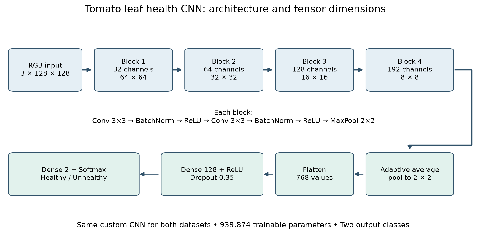
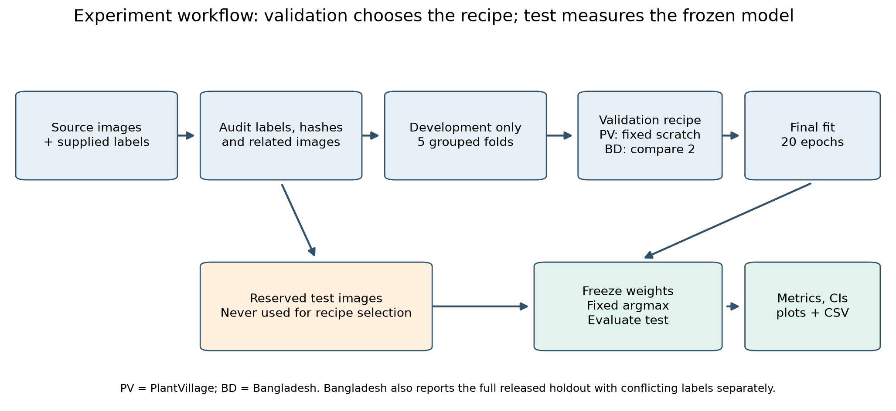

# How these CNNs work

The model receives a colour photograph and predicts two scores: Healthy and Unhealthy. It learns visual patterns from labelled examples; it does not contain hand-written rules for spots, yellowing, or damage. It does not identify the particular disease or verify that the photograph depicts a tomato.

## From image to decision

1. EXIF orientation is applied, then the image is converted to RGB and resized to 128×128. Pixel values are scaled to [-1,1]. Training and prediction use the same normalization.
2. Four convolution blocks use 32, 64, 128, and 192 channels. Each block contains two learned 3×3 convolutions, batch normalization, ReLU, and 2×2 max pooling. Pooling changes the spatial sizes from 128 to 64, 32, 16, and finally 8 pixels per side.
3. Adaptive average pooling reduces the last feature map to 192×2×2. Flattening produces 768 values. A dense layer maps these to 128 values; ReLU and dropout 0.35 follow.
4. A final dense layer produces two logits. Softmax converts them to two scores summing to one. The larger score wins (argmax). None of the models uses a threshold adjusted against its test results.

There are **939,874 trainable parameters**. The first-layer filter figures show actual learned 3×3 RGB weights, individually rescaled so they can be seen. They do not explain why a particular photograph received a prediction.

## Learning during training

For each training batch, the CNN predicts the labels, cross entropy measures the errors, backpropagation calculates gradients, and AdamW updates the weights. Cosine scheduling reduces the learning rate across a fit. Weight decay and dropout provide regularization. Geometry and mild brightness/colour augmentation are applied only after the data have been split, and only to training examples.

PlantVillage has many more unhealthy than healthy images. Its recorded binary recipe uses class weights derived from the current training fold, so healthy errors contribute more to the loss. Its architecture/initialization recipe is fixed; five grouped validation folds estimate it, and the final model is trained from scratch on all development images.

Bangladesh uses exactly **32 Healthy + 32 Unhealthy draws per batch**, cycling each training pool with reshuffling and augmentation. All available eligible training images are covered each epoch; repetitions are not independent new leaves. Cross entropy is unweighted because sampling already balances exposure. Five grouped folds compare scratch training with adapting PlantVillage features and a new binary head. Scratch had higher validation balanced accuracy and was selected. The final model uses all eligible development images for 20 epochs.

Each validation fit uses 10 epochs. A fold's validation images are not used to update that model. The final test is reserved until after recipe selection. The shipped training histories and prediction CSVs are actual recorded evidence, not illustrative scores.

### Additional experiment: PlantVillage first, then Bangladesh

The new `train_finetune.py` starts from the complete trained PlantVillage binary model. It keeps the learned convolution filters, dense layers, BatchNorm state and Healthy/Unhealthy output head. Every Bangladesh fold starts independently from the same original checkpoint, so validation images cannot leak into the next fold through previously trained weights. All layers are then updated using Bangladesh training images and balanced batches.

Five grouped development folds compare a learning rate of 0.0001 for all layers against 0.00003 for features / 0.0003 for the classifier. These fits use 20 epochs. Validation balanced accuracy selects the recipe; the final model reloads the original PlantVillage weights and trains on all 801 development images for 30 epochs. It then evaluates the reused Bangladesh holdout with fixed argmax. This is full-model fine-tuning, distinct from the earlier experiment that initialized a new output head.

The resulting primary accuracy was **87.77%**, with **86.89% macro F1**, below scratch training's **94.96% / 94.75%**. Starting with learned features therefore did not improve this particular experiment. Controlled-background features and the small field dataset can make adaptation difficult; that is an explanation to investigate, not a measured causal finding. See [FINETUNING_RESULTS.md](FINETUNING_RESULTS.md) for curves, paired comparisons, unequal training budgets and the exploratory nature of repeatedly using the same holdout.

## Read the metrics correctly

Unhealthy is the positive class. Confusion matrices have reference classes in rows and predictions in columns:

| | Predicted Healthy | Predicted Unhealthy |
|---|---:|---:|
| Reference Healthy | True negative (TN) | False positive (FP) |
| Reference Unhealthy | False negative (FN) | True positive (TP) |

| Metric | Meaning |
|---|---|
| Accuracy | Fraction of all images classified correctly. |
| Healthy recall / specificity | TN / (TN + FP): fraction of healthy leaves recognized. |
| Unhealthy recall / sensitivity | TP / (TP + FN): fraction of unhealthy leaves recognized. |
| Unhealthy precision | TP / (TP + FP): fraction of predicted-unhealthy leaves that are unhealthy. |
| Class F1 | Harmonic mean of that class's precision and recall. |
| Macro F1 | Mean of Healthy F1 and Unhealthy F1, giving both classes equal weight. |
| Balanced accuracy | Mean of Healthy recall and Unhealthy recall. |
| Weighted F1 | Class F1 averaged using class supports; a majority class can dominate. |
| ROC AUC | Ranking performance across score cutoffs; it does not demonstrate probability calibration. |
| Average precision | Precision–recall summary; interpret alongside the Unhealthy prevalence baseline. |

The bootstrap intervals resample the recorded groups 2,000 times. They describe sampling uncertainty under that grouping, not every source of uncertainty. Missing plant/photo-session metadata and label errors can matter beyond those intervals. No observed errors in one class can produce a degenerate bootstrap recall interval; it is not a guarantee of perfect future performance.

## Why the Bangladesh scores have two columns

The archive contains 1,030 images and 1,028 annotations. Some Healthy/Unhealthy filename labels disagree with their annotation IDs, and one annotation has zero area. The primary experiment retains only examples whose supplied labels agree and whose annotations pass the predefined checks. This leaves 801 development and 139 primary-test images.

The full released holdout has 160 images. It is also scored against its filename labels, but 21 of those labels conflict with the annotations. Its score is reported as a descriptive result with uncertain references. The 139-image score must not be described as accuracy on every original image. Neither score was used to select the recipe.

PlantVillage and Bangladesh have different image populations and capture conditions. Their own-dataset scores do not establish generalization to new gardens, phone cameras, whole plants, or unrelated images. See [RESULTS.md](RESULTS.md) for the measured results and [DATA_SOURCES.md](DATA_SOURCES.md) for the data limitations.
