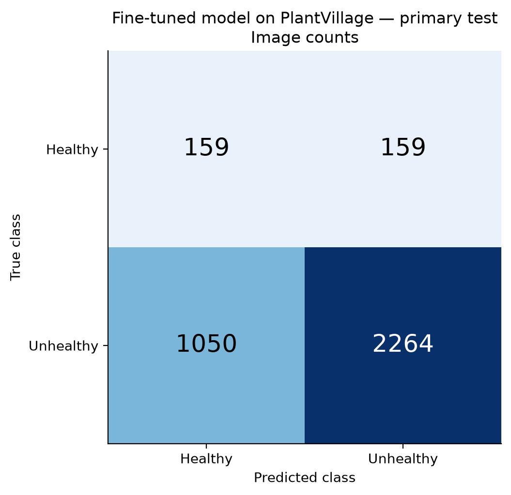
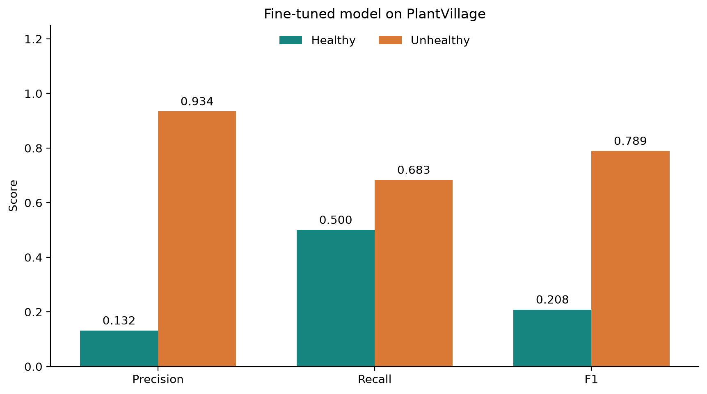
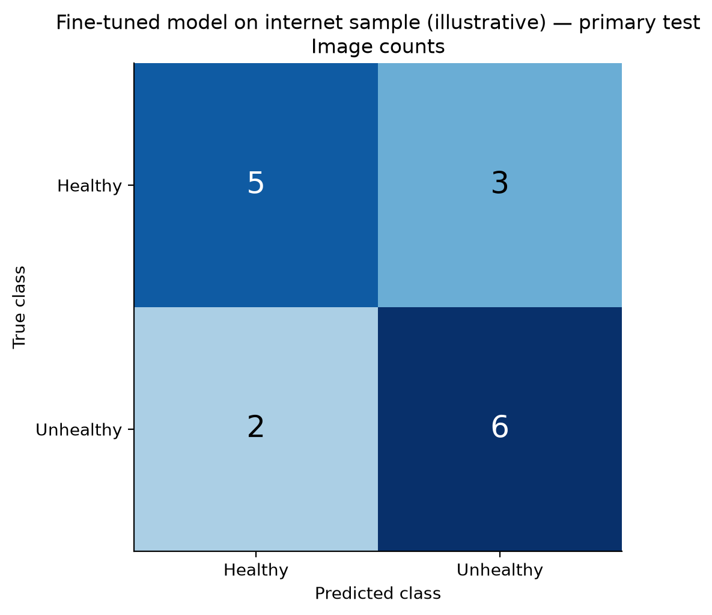
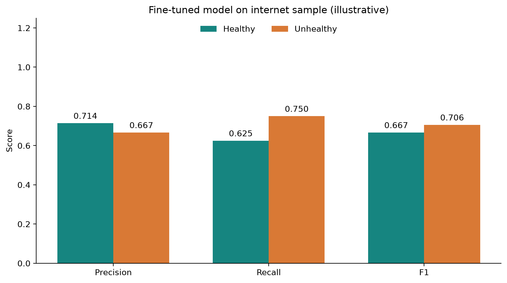

# Frozen PlantVillage → Bangladesh model: additional testing

The same completed fine-tuned binary model is evaluated unchanged on PlantVillage's reserved test split and an additional internet-photo sample. No new training, threshold tuning, image-specific crop or model selection was performed. Inputs use the recorded EXIF orientation, RGB, 128×128 resize and [-1,1] normalization; prediction is float32 with fixed argmax.

| Evaluation population | Images | Accuracy | Balanced accuracy | Macro F1 | Healthy recall | Unhealthy recall |
|---|---:|---:|---:|---:|---:|---:|
| Bangladesh primary (reused) | 139 | 87.77% | 85.82% | 86.89% | 72.88% | 98.75% |
| PlantVillage test (reused) | 3632 | 66.71% | 59.16% | 49.88% | 50.00% | 68.32% |
| Internet convenience sample (weak labels) | 16 | 68.75% | 68.75% | 68.63% | 62.50% | 75.00% |

## PlantVillage retention check

The unchanged original test split contains 3,632 images: 318 Healthy and 3,314 Unhealthy. All test file and decoded-pixel hashes were checked against the original manifest, and their hashes are disjoint from both stages' development images. This is a previously inspected controlled-image benchmark; it is not independent field validation.

Before Bangladesh fine-tuning, the archived PlantVillage model scored **99.86% accuracy / 99.57% macro F1** on this split. After fine-tuning, the new checkpoint scored **66.71% / 49.88%**. Its PlantVillage performance dropped substantially. This measures reduced retention of the original domain; it does not identify which weight/statistic changes caused the drop.

An always-Unhealthy classifier would get **91.24% accuracy** on this imbalanced split, but only 50% balanced accuracy. The fine-tuned model recognized **159/318 Healthy** and **2264/3,314 Unhealthy**. Accuracy alone would obscure this behaviour.





## Internet-photo check: scope and label quality

The final sample contains **16 images**, with **8 apparently Healthy and 8 Unhealthy**. Candidates came from [Wikimedia Commons tomato-leaf categories](https://commons.wikimedia.org/wiki/Category:Solanum_lycopersicum_leaves) and University of Maryland Extension's [tomato problem guide](https://extension.umd.edu/resource/key-common-problems-tomatoes) / [bacterial-disease guide](https://extension.umd.edu/resource/bacterial-diseases-tomato), rather than from an unbiased sample of the entire internet. After reviewing image content and source descriptions and excluding overlaps/duplicate views, a reproducible seeded draw selected the fixed sample before inference (seed 20261022). It is random only within that reviewed convenience pool. Host rate limits prevented further Commons image downloads; that availability limit is recorded, and no predictions were used to select sources.

The Healthy references are predominantly **visual assessments of apparently asymptomatic foliage**, not confirmed absence of disease. Unhealthy references use source captions/descriptions plus visible symptoms; they include pest damage and noninfectious stress in keeping with the broad binary task. These are weak reference labels, so accuracy and F1 below are illustrative agreement with those labels, not validated diagnostic accuracy or a claim about arbitrary internet images. Some photos show multiple leaves/backgrounds, providing an additional framing shift.

Source descriptions, authors, available file revision identifiers, download URLs, attribution/terms, image hashes, pre-prediction review notes, exclusions and the final sample are retained in the cross_dataset directory. Wikimedia 960-pixel thumbnails are used when originals are larger; extension photos use the publisher-provided image size. There is no manual leaf cropping. Conservative exact-pixel/perceptual checks against all PlantVillage and Bangladesh images identified no retained matches at the recorded cutoff; incomplete source metadata cannot establish total independence.

The model recognized **5/8 apparently Healthy** and **6/8 Unhealthy** photos. Small-sample uncertainty and label errors limit interpretation. Images with uncertain health/content were excluded before predictions, rather than removed because the model got them wrong.





## Individual internet predictions

| Source image | Reference | Prediction | Unhealthy softmax | Reference basis |
|---|---|---|---:|---|
| [Healthy tomato leaves (7871755330).jpg](https://commons.wikimedia.org/wiki/File:Healthy_tomato_leaves_(7871755330).jpg) | Healthy | Healthy | 0.053 | Source title says healthy; visually apparently asymptomatic |
| [Folla Tomate 006eue.jpg](https://commons.wikimedia.org/wiki/File:Folla_Tomate_006eue.jpg) | Healthy | Unhealthy | 0.938 | Manual visual assessment: apparently asymptomatic; health unconfirmed |
| [Lycopersicon esculentum - Tomato from Wayanad (5).jpg](https://commons.wikimedia.org/wiki/File:Lycopersicon_esculentum_-_Tomato_from_Wayanad_(5).jpg) | Healthy | Unhealthy | 0.879 | Manual visual assessment: apparently asymptomatic; health unconfirmed |
| [Solanum lycopersicum 15-p.bot-lyco.escu-001.jpg](https://commons.wikimedia.org/wiki/File:Solanum_lycopersicum_15-p.bot-lyco.escu-001.jpg) | Healthy | Healthy | 0.065 | Manual visual assessment: apparently asymptomatic; health unconfirmed |
| [Starr 080117-2163 Solanum lycopersicum var. lycopersicum.jpg](https://commons.wikimedia.org/wiki/File:Starr_080117-2163_Solanum_lycopersicum_var._lycopersicum.jpg) | Healthy | Healthy | 0.046 | Manual visual assessment: apparently asymptomatic; health unconfirmed |
| [Starr 080607-7266 Solanum lycopersicum var. lycopersicum.jpg](https://commons.wikimedia.org/wiki/File:Starr_080607-7266_Solanum_lycopersicum_var._lycopersicum.jpg) | Healthy | Healthy | 0.430 | Manual visual assessment: apparently asymptomatic; health unconfirmed |
| [Starr 080614-9730 Solanum lycopersicum var. lycopersicum.jpg](https://commons.wikimedia.org/wiki/File:Starr_080614-9730_Solanum_lycopersicum_var._lycopersicum.jpg) | Healthy | Unhealthy | 0.930 | Manual visual assessment: apparently asymptomatic; health unconfirmed |
| [2023-09-28 15 01 59 Leaves and flowers on a tomato plant along High Acres Avenue in the Mountainview section of Ewing Township, Mercer County, New Jersey.jpg](https://commons.wikimedia.org/wiki/File:2023-09-28_15_01_59_Leaves_and_flowers_on_a_tomato_plant_along_High_Acres_Avenue_in_the_Mountainview_section_of_Ewing_Township,_Mercer_County,_New_Jersey.jpg) | Healthy | Healthy | 0.461 | Manual visual assessment: apparently asymptomatic; health unconfirmed |
| [Early blight on tomato leaves (7871930010).jpg](https://commons.wikimedia.org/wiki/File:Early_blight_on_tomato_leaves_(7871930010).jpg) | Unhealthy | Unhealthy | 0.546 | Source identifies disease/damage; visible symptoms reviewed |
| [Early blight on foliage](https://extension.umd.edu/resource/key-common-problems-tomatoes) | Unhealthy | Healthy | 0.445 | Source identifies disease/damage; visible symptoms reviewed |
| [Cold injury to foliage](https://extension.umd.edu/resource/key-common-problems-tomatoes) | Unhealthy | Unhealthy | 0.687 | Source identifies disease/damage; visible symptoms reviewed |
| [Early blight on leaves](https://extension.umd.edu/resource/key-common-problems-tomatoes) | Unhealthy | Unhealthy | 0.554 | Source identifies disease/damage; visible symptoms reviewed |
| [Spider-mite feeding damage](https://extension.umd.edu/resource/key-common-problems-tomatoes) | Unhealthy | Healthy | 0.383 | Source identifies disease/damage; visible symptoms reviewed |
| [Fusarium wilt symptoms](https://extension.umd.edu/resource/key-common-problems-tomatoes) | Unhealthy | Unhealthy | 0.746 | Source identifies disease/damage; visible symptoms reviewed |
| [Bacterial spot on foliage](https://extension.umd.edu/resource/bacterial-diseases-tomato) | Unhealthy | Unhealthy | 0.936 | Source identifies disease/damage; visible symptoms reviewed |
| [Bacterial spot on garden foliage](https://extension.umd.edu/resource/bacterial-diseases-tomato) | Unhealthy | Unhealthy | 0.733 | Source identifies disease/damage; visible symptoms reviewed |

## Uncertainty and reproducibility

Each result folder includes per-image prediction CSVs, class precision/recall/F1, 2,000 group-bootstrap intervals, a frozen evaluation manifest and verification.json. Intervals do not account for all label uncertainty, missing plant/source relationships, or repeated benchmark use. Softmax scores are not guaranteed calibrated probabilities.

```powershell
# Source datasets must already be downloaded for this inference:
python evaluate_finetuned.py --dataset plantvillage

# Restore the exact selected web thumbnails from their recorded URLs:
python restore_internet_sample.py
python evaluate_finetuned.py --dataset internet

# Verify/rebuild tables and charts without running inference:
python report_cross_evaluation.py
```

Completed evaluation results are reused after checkpoint verification. Restoring files verifies their exact downloaded SHA-256 hashes and stops if a source file has changed. Raw downloaded web photos and pre-prediction review sheets are local data, not bundled with the repository; links/attribution remain available in the manifest. Original trained models and earlier result files are preserved.
