# PlantVillage first, then Bangladesh: measured fine-tuning results

This additional model starts from the existing trained PlantVillage binary checkpoint and updates every layer on Bangladesh development data. It retains the trained Healthy/Unhealthy output head, unlike the earlier feature-adaptation experiment that reset that head. The original two models/results remain available.

## Measured comparison on the same Bangladesh images

| Model / cohort | Images | Accuracy | Balanced accuracy | Macro F1 | Healthy recall | Unhealthy recall |
|---|---:|---:|---:|---:|---:|---:|
| Bangladesh scratch / primary | 139 | 94.96% | 94.07% | 94.75% | 88.14% | 100.00% |
| Bangladesh scratch / full_holdout_uncertain_labels | 160 | 83.75% | 83.75% | 83.31% | 67.50% | 100.00% |
| PV then Bangladesh fine-tuned / primary | 139 | 87.77% | 85.82% | 86.89% | 72.88% | 98.75% |
| PV then Bangladesh fine-tuned / full_holdout_uncertain_labels | 160 | 79.38% | 79.38% | 78.57% | 60.00% | 98.75% |

Fine-tuning changed primary-test accuracy by **-7.19 percentage points** and macro F1 by **-7.86 points** versus the archived scratch model. In paired predictions, 3 images changed from wrong to correct and 13 changed from correct to wrong.

This is an exploratory comparison on a previously inspected holdout. Recipes were selected using development folds only, but the study as a whole has already inspected these test images. The new default budget is 20 CV epochs / 30 final epochs, versus 10/20 for archived scratch; these scores do not isolate the effect of initialization at equal training budget. The 139-image cohort requires supplied label agreement; the full 160-image cohort includes 21 conflicting labels. Neither proves generalization to new gardens.

## Training stages and validation selection

1. Reuse the PlantVillage binary CNN trained on **14,528 development images**. Its **3,632 benchmark test images were excluded from weight training**; no new PlantVillage pretraining was needed.
2. Audit source overlap and reuse the same **801 Bangladesh development images**, **139 primary test images**, released 160-image holdout and five grouped folds as the scratch experiment.
3. For each fold and recipe, load the exact complete PlantVillage checkpoint afresh. Keep all layers trainable, including the output head, and update BatchNorm running statistics. Use original train-only augmentation and exactly 32 Healthy / 32 Unhealthy draws per default batch, with unweighted cross entropy.
4. Choose the recipe with highest mean final-epoch validation balanced accuracy; macro F1 breaks ties. Reload PlantVillage weights afresh and train on all Bangladesh development images. Save the final weights before one pass over the released holdout. Use fixed argmax decisions.

| Fine-tuning recipe | Feature LR | Classifier LR | Mean CV balanced accuracy | Mean CV macro F1 |
|---|---:|---:|---:|---:|
| full_finetune | 0.0001 | 0.0001 | 75.89% | 76.24% |
| differential_finetune | 3e-05 | 0.0003 | 63.19% | 61.99% |

Selected recipe: **full_finetune**. AdamW uses weight decay 0.0001 and a cosine schedule to 0.000001. Architecture remains 939,874 parameters, 128×128 RGB, [-1,1] normalization.

Full-model fine-tuning is a standard transfer-learning approach; see the [official PyTorch tutorial](https://docs.pytorch.org/tutorials/beginner/transfer_learning_tutorial.html). It is a reasonable experiment because both datasets involve tomato leaves, but controlled-image features can transfer poorly to natural backgrounds.

## Class metrics and uncertainty

| Class | Precision | Recall | F1 | Support |
|---|---:|---:|---:|---:|
| Healthy | 97.73% | 72.88% | 83.50% | 59 |
| Unhealthy | 83.16% | 98.75% | 90.29% | 80 |

ROC AUC: **0.9532**. Average precision: **0.9478**. Weighted F1: **87.40%**. Unhealthy is the positive class. Raw prediction scores and all class metrics are retained as CSV files.

95% intervals use 2,000 group-bootstrap draws and appear in confidence_intervals.csv / .json. They do not capture label uncertainty, all same-plant relationships, repeated test inspection or deployment shift. Paired prediction counts and an exploratory exact McNemar statistic are in paired_comparison.csv; no confirmatory inference is claimed.

## Figures for reuse

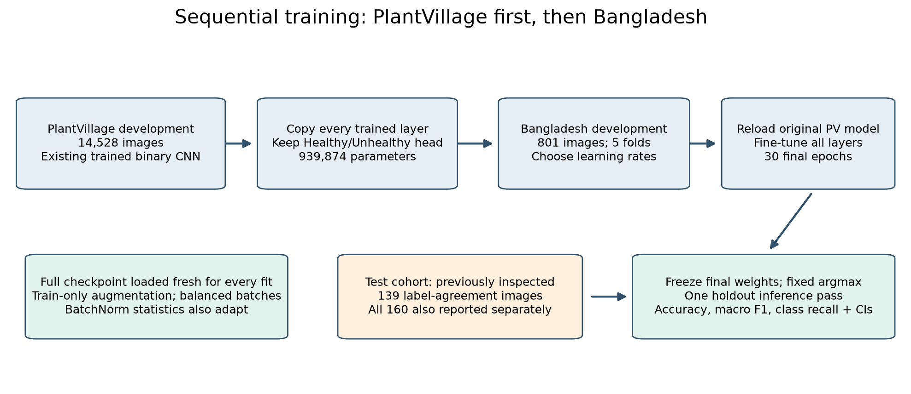

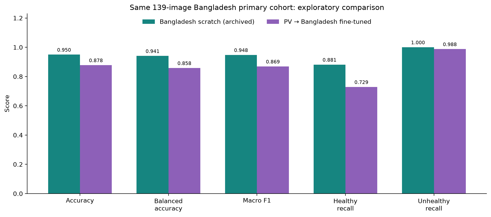

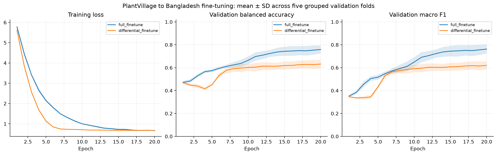

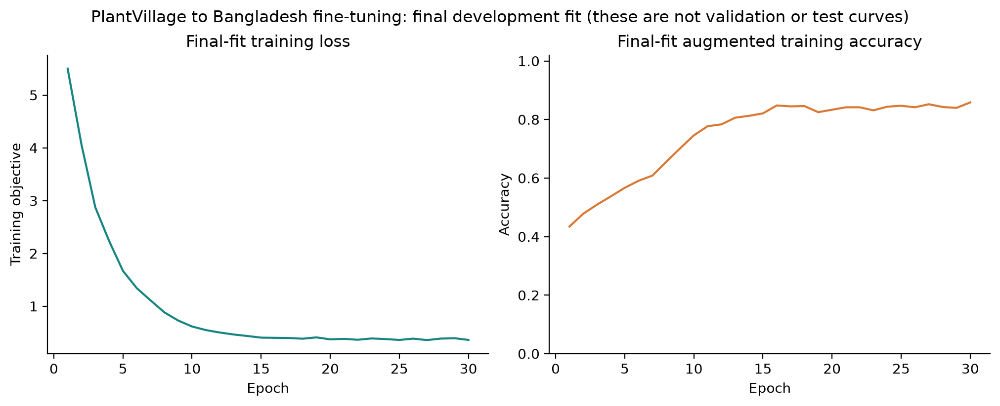

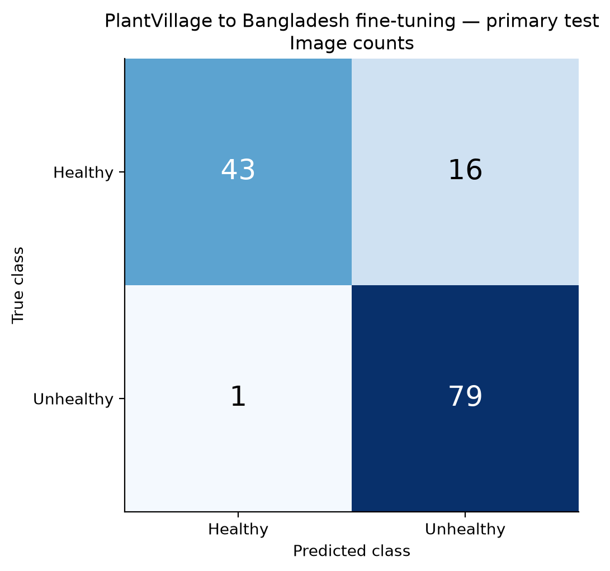

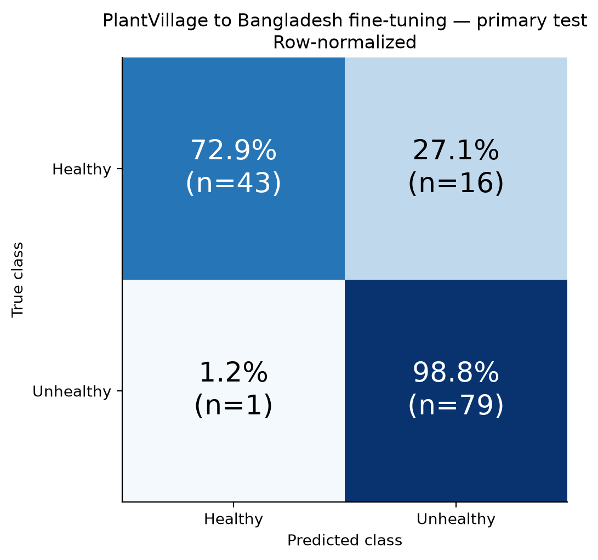

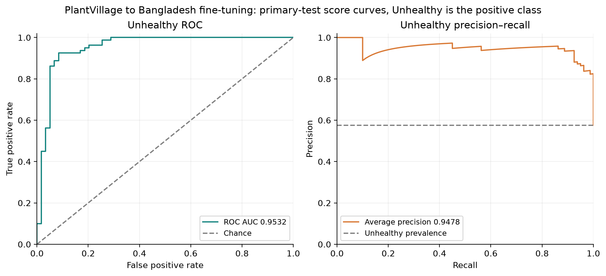

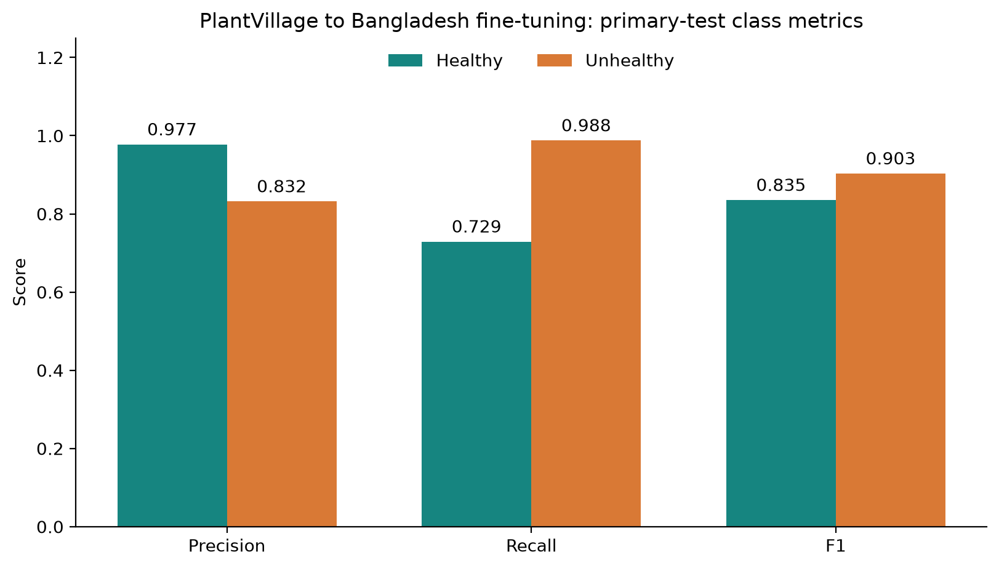

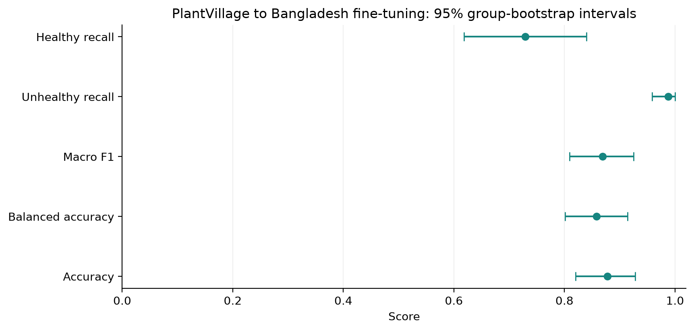

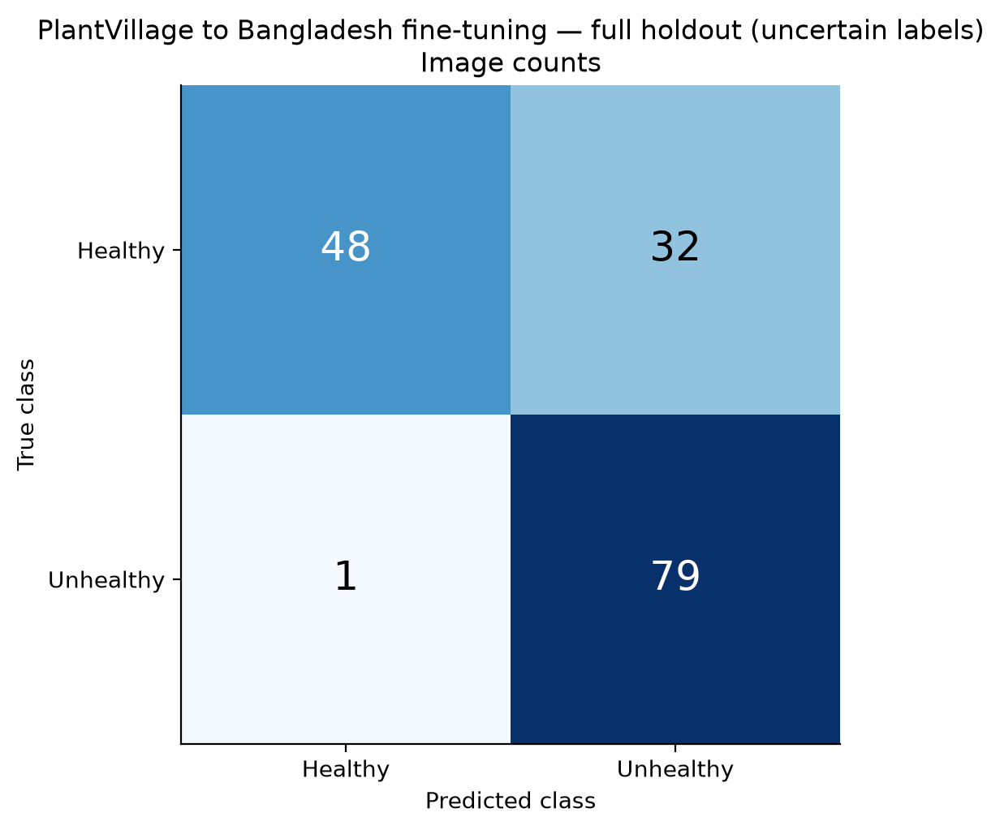

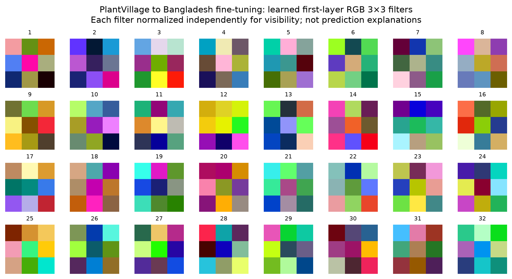

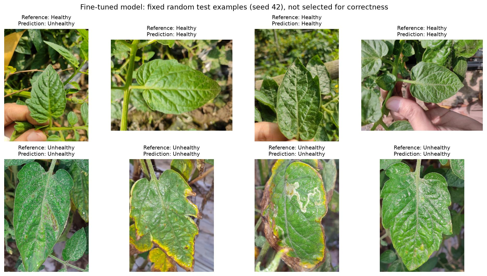

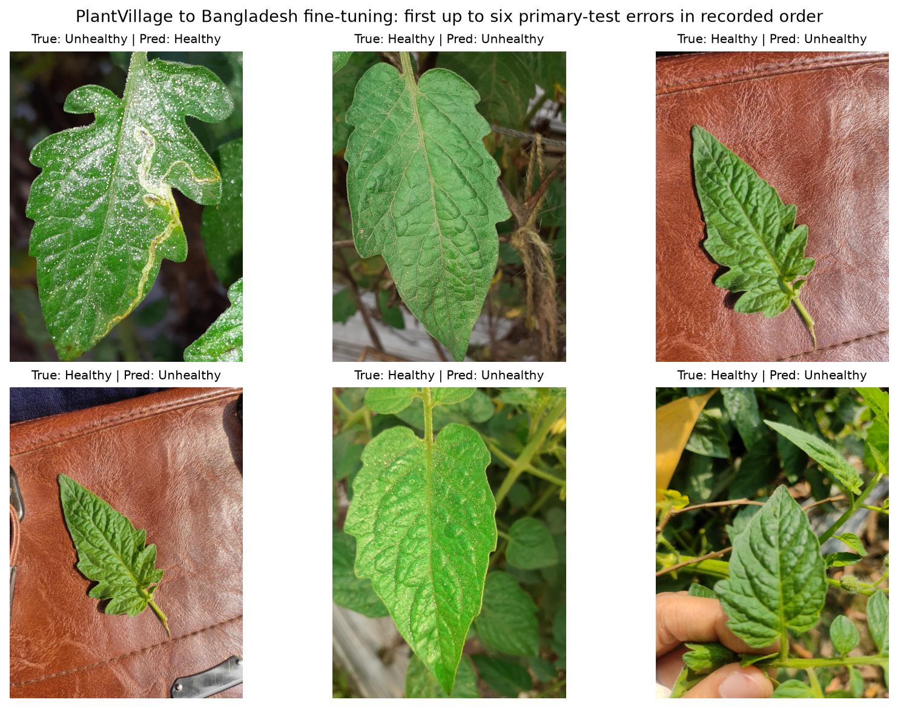

## Use and reproduce

```powershell
python predict.py "C:\path\to\leaf.jpg" --dataset bangladesh-finetuned
python verify_results.py --dataset bangladesh-finetuned
python report_finetune.py
python execute_notebook.py PlantVillage_Bangladesh_Finetuning.ipynb

# New training run; completed outputs are protected:
python train_finetune.py --output runs/bangladesh-finetuned-new
```

New computers need both source datasets downloaded and the PlantVillage fingerprint cache for fresh training. Use python download_data.py, python download_bangladesh.py, and python ensure_plantvillage_fingerprints.py first. Prediction, verification and notebook review use the tracked checkpoint/results on CPU.

The checkpoint is bangladesh_finetuned_outputs/tomato_cnn_finetuned.pt. All new evidence is stored separately in bangladesh_finetuned_outputs/. Dataset attribution and label/grouping limitations remain in DATA_SOURCES.md and BANGLADESH_LICENSE.txt. Rebuilding the report never runs inference; rebuilding the notebook source clears its displayed outputs, which can be refreshed with execute_notebook.py.
