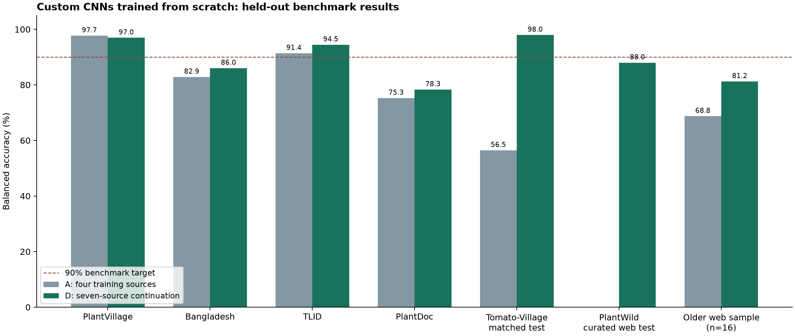

# Tomato leaf disease detection with a custom CNN

A PyTorch CNN that classifies tomato foliage as **Healthy** or **Unhealthy**. It was trained from random weights across seven data sources. Later stages continue only this project's own checkpoints; no ResNet, ImageNet weights or other externally pretrained model is used.

The selected model is included as [`best_model.pt`](best_model.pt). It has 955,194 parameters and accepts 160 × 160 RGB images. Unhealthy includes source-labelled disease, insect damage, nutrient deficiency and other visible damage. It does not identify a specific disease.

## Run a prediction

Tested with Python 3.12. These commands use PowerShell on Windows:

```powershell
git clone https://github.com/kzy09c/cnn-plant-disease-detection.git
cd cnn-plant-disease-detection
py -3.12 -m venv .venv
.\.venv\Scripts\python.exe -m pip install -r inference-requirements.txt
.\.venv\Scripts\python.exe predict.py "C:\path\to\tomato_leaf.jpg"
```

On Linux/macOS, create the environment with `python3.12 -m venv .venv` and use `.venv/bin/python` in place of `.\.venv\Scripts\python.exe`.

The command returns JSON with the predicted class and both model probabilities. It uses CUDA when available and otherwise runs on CPU. Choose another checkpoint with `--model path/to/checkpoint.pt`. Use a clear, close photograph of tomato foliage. Scores are uncalibrated; the classifier does not verify plant species, locate leaves or reliably reject unfamiliar inputs.

For a standalone copy, download [`tomato_cnn_inference.zip`](tomato_cnn_inference.zip), extract it, install `inference-requirements.txt`, and run `python predict.py your_image.jpg` from the extracted folder. Prediction requires no training data.

## Measured results

These held-out results use the delivered seven-source model, selected using validation data. Balanced accuracy averages Healthy and Unhealthy recall, which matters because several tests contain very few Healthy images.

| Dataset | Test images | Accuracy | Balanced accuracy |
|---|---:|---:|---:|
| PlantVillage | 3,632 | 94.47% | 96.97% |
| Bangladesh | 139 | 87.77% | 86.04% |
| TLID | 3,050 | 92.59% | 94.48% |
| PlantDoc | 69 | 86.96% | 78.33% |
| Tomato-Village | 1,764 | 95.98% | 97.96% |
| PlantWild | 433 | 90.99% | 88.01% |
| Tomato-Disease annotation regions | 488 regions | 93.85% | 93.62% |

PlantWild is a curated internet-scene check with 26 apparently Healthy and 407 source-labelled Unhealthy test photos. Always predicting Unhealthy would achieve 94.00% accuracy but only 50% balanced accuracy. The model also agreed with 13 of 16 weak reference labels in an older web-photo convenience sample. Neither check establishes accuracy on arbitrary random internet images.

The original target of 90% balanced accuracy on each of the five initial benchmark sources was met on three: Bangladesh and PlantDoc remained below target. The later PlantWild check also remains below 90%. Older benchmarks were inspected in previous work, so their comparisons are exploratory. The annotated-region check assumes supplied bounding boxes.

See [`RESULTS.md`](RESULTS.md) for all experiments, class recalls, macro F1, confusion matrices and uncertainty. [`MODEL_CARD.md`](MODEL_CARD.md) describes intended use and limitations.



## Architecture and training

`model.py` defines four convolutional stages with 32, 64, 128 and 192 channels. Each stage uses two 3 × 3 convolutions, BatchNorm, SiLU and max pooling. The selected recipe adds channel attention, adaptive 2 × 2 pooling and a dense classifier. Images are EXIF-corrected, converted to RGB, resized with bilinear interpolation and normalized with `x / 127.5 - 1`.

Training draws equally from each source × health-class bucket with replacement. Duplicate families and source-photo groups stay in one partition. Validation balanced accuracy determines checkpoint selection; the classification threshold stays at 0.5. Six completed fits compare augmentation, mixup, attention and additional sources.

| Stage | Training sources | Initialization |
|---|---|---|
| A | PlantVillage, Bangladesh, TLID, PlantDoc | Random weights; three recipes |
| B | A + Tomato-Village | Random weights with the selected recipe |
| C | B + Tomato-Disease regions | This project's B checkpoint with joint replay |
| D, delivered | C + PlantWild | This project's C checkpoint with joint replay |

[`EXPERIMENT_PROTOCOL.md`](EXPERIMENT_PROTOCOL.md) records source links, attribution, licences, label decisions and grouping rules. Dataset photographs, caches and local review sheets are excluded from this repository. Source datasets retain their own terms, including PlantWild's CC BY-NC-ND 4.0 terms.

## Verify saved results

Install the full requirements to review the experiment. Saved prediction metrics and checkpoint identities can be verified on CPU without datasets:

```powershell
.\.venv\Scripts\python.exe -m pip install -r requirements.txt
.\.venv\Scripts\python.exe verify_results.py
.\.venv\Scripts\python.exe -m unittest discover -s tests -v
```

Dataset-dependent unit checks are skipped when local audited manifests are absent. Saved draw-count checks still run against the included training records. Frozen records preserve original run paths as provenance; the verifier resolves checkpoint identities to the included `runs/` files.

## Training reproduction

Training and fresh dataset evaluation require CUDA. The recorded environment used Python 3.12, PyTorch 2.11.0+cu128 and an RTX 4070 Ti SUPER. Install a compatible CUDA-enabled PyTorch build and the full requirements.

**Full reproduction requires additional local inputs.** Initial preparation reads audited manifests and images from earlier PlantVillage, Bangladesh, TLID and PlantDoc experiments. A fresh clone does not download those inputs. Copy `local_config.example.json` to `local_config.json` and configure both source-project paths. Git ignores your local configuration.

The preparation and training sequence was:

```text
prepare_data.py
inspect_sources.py → download_tomatovillage.py → prepare_external.py → prepare_field.py
train.py --epochs 30 --steps 64 --suffix _v1
train_field.py
download_zenodo.py → prepare_zenodo.py → train_extra.py → select_final.py
inspect_plantwild.py → download_plantwild.py → prepare_plantwild.py
train_wild.py → select_wild.py
```

Arrows indicate order, not a shell command. PlantWild also requires archived source metadata and the frozen manual decisions in `data/plantwild/healthy_review.csv`. Restore those local audit inputs to reproduce the same splits; treating every generic leaf photo as Healthy changes the experiment. The optional GTLD check contains just seven publisher examples. Read the protocol before creating new experiments. Completed run names and evaluation directories are protected against overwrite.

## Files

| Path | Purpose |
|---|---|
| `predict.py`, `model.py`, `best_model.pt` | Prediction code, architecture and selected weights |
| `prepare_*.py`, `download_*.py`, `inspect_*.py` | Data preparation, source checks, grouping and downloads |
| `train*.py`, `select_*.py` | Training and validation selection |
| `evaluate.py`, `verify_results.py`, `report.py` | Fresh evaluation, saved-result verification and local reporting |
| `runs/` | Completed checkpoints, configurations, histories, draw counts and historical source snapshots |
| `evaluation_a/` through `evaluation_final/` | Frozen identities, individual predictions and metrics |
| `RESULTS.md`, `RESULTS.csv`, `figures/` | Measured results and numerical plots |
| `tomato_cnn_inference.zip` | Standalone inference package |

Model SHA-256: `e905416007b09d826595af17fa4f5d5b15c103c973790853f707de73a38f1108`.
