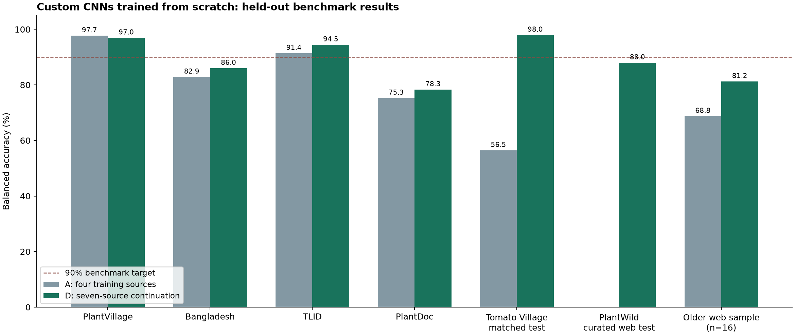

# Tomato leaf disease detection with a custom CNN

A PyTorch CNN that classifies tomato foliage as **Healthy** or **Unhealthy**. It was trained from random weights across seven data sources. Later stages continue only this project's own checkpoints; no ResNet, ImageNet weights or other externally pretrained model is used.

The selected model is included as [`best_model.pt`](best_model.pt). It has 955,194 parameters and accepts 160 × 160 RGB images. Unhealthy includes source-labelled disease, insect damage, nutrient deficiency and other visible damage. It does not identify a specific disease.

**First time using the project?** Follow the [installation guide](#installation-guide-windows--vs-code) at the bottom of this README.

**Prefer a guided notebook?** Open the [executed Jupyter walkthrough](pipeline_walkthrough.ipynb) for data loading, preprocessing, CNN features, recorded training curves and checks of saved predictions. Outputs are included for reading on GitHub; the default walkthrough runs on CPU without downloading datasets.

<p align="center"></p>

## Run a prediction

After installing the project, run this command from its folder with the virtual environment active:

```powershell
python predict.py "C:\path\to\tomato_leaf.jpg"
```

The command returns JSON with the predicted class and both model probabilities. It uses CUDA when available and otherwise runs on CPU. Choose another checkpoint with `--model path/to/checkpoint.pt`. Use a clear, close photograph of tomato foliage. Scores are uncalibrated; the classifier does not verify plant species, locate leaves or reliably reject unfamiliar inputs.

For a standalone copy, download [`tomato_cnn_inference.zip`](tomato_cnn_inference.zip), extract it, install `inference-requirements.txt`, and run `python predict.py your_image.jpg` from the extracted folder. Prediction requires no training data.

## Measured results

These held-out results use the delivered seven-source model, selected using validation data. Each source below also contributed separate training images. Balanced accuracy averages Healthy and Unhealthy recall, which matters because several tests contain very few Healthy images.

| Dataset | Test images | Accuracy | Balanced accuracy |
|---|---:|---:|---:|
| PlantVillage | 3,632 | 94.47% | 96.97% |
| Bangladesh | 139 | 87.77% | 86.04% |
| TLID | 3,050 | 92.59% | 94.48% |
| PlantDoc | 69 | 86.96% | 78.33% |
| Tomato-Village | 1,764 | 95.98% | 97.96% |
| PlantWild | 433 | 90.99% | 88.01% |
| Tomato-Disease annotation regions | 488 regions | 93.85% | 93.62% |

PlantWild is a curated internet-scene check with 26 apparently Healthy and 407 source-labelled Unhealthy test photos. Always predicting Unhealthy would achieve 94.00% accuracy but only 50% balanced accuracy. The model also agreed with 13 of 16 weak reference labels in an older web-photo convenience sample. Neither check establishes accuracy on arbitrary random internet images.

The original target of 90% balanced accuracy on each of the five initial benchmark sources was met on three: Bangladesh and PlantDoc remained below target. The later PlantWild check also remains below 90%. Older benchmarks were inspected in previous work, so their comparisons are exploratory. The annotated-region check assumes supplied bounding boxes.

See [`RESULTS.md`](RESULTS.md) for the original training experiments, class recalls, macro F1, confusion matrices and uncertainty. [`MODEL_CARD.md`](MODEL_CARD.md) describes intended use and limitations.



## Pakistan dataset: external category-matched test

The unchanged model was also tested using the [Tomato Leaf Disease Classification Dataset in Pakistan, release 2](https://data.mendeley.com/datasets/3mbnb82mxd/2). Its six category names also occur in the training data. The model still predicts **Healthy or Unhealthy**; the table breaks down correct binary decisions by the publisher's disease category.

The archive contains 830 raw images and 7,200 augmented images. Only raw images were considered. Before prediction, 357 entries from photo families overlapping earlier data and 12 additional duplicate/cropped/resized copies were excluded. The remaining **461 images** had no detected matches in the recorded hash, structural and geometric checks. The whole release cannot be described as an independent unseen collection; undetected overlap and shared acquisition sessions can remain.

**408/461 correct (88.50% accuracy), 85.37% balanced accuracy, 84.87% macro F1.** The model was not retrained, and its threshold stayed at 0.5.

| Reference category | Correct / tested | Incorrect | Correct rate |
|---|---:|---:|---:|
| Healthy | 91 / 115 | 24 | 79.13% |
| Early blight | 68 / 76 | 8 | 89.47% |
| Late blight | 26 / 30 | 4 | 86.67% |
| Leaf mold | 146 / 146 | 0 | 100.00% |
| Septoria leaf spot | 60 / 61 | 1 | 98.36% |
| Yellow leaf curl virus | 17 / 33 | 16 | 51.52% |

Leaf mold and Septoria performed strongly in this cohort. Yellow leaf curl was the weakest check: 16 of its 33 images were incorrectly marked Healthy. The overall balanced accuracy remains below the 90% target, and this result does not establish internet-wide accuracy.

Read the [full report](evaluation_unseen_matching/REPORT.md), [individual predictions](evaluation_unseen_matching/predictions.csv), [all 830 audit decisions](evaluation_unseen_matching/audit_manifest.csv) and [dataset source/download guide](dataset_sources/pakistan/README.md). The source photographs are available from the original CC BY 4.0 release; this repository includes metadata, download tools and evaluation evidence. Saved metrics can be checked without downloading the images using `python verify_results.py`.

## Data and modelling pipeline

The preprocessing pipeline combines seven tomato-image sources into a binary task: **Healthy = 0** and **Unhealthy = 1**. Unhealthy includes source-labelled disease, insect damage and nutrient deficiency. Source labels are retained as reference labels; preprocessing does not establish a biological diagnosis.

### 1. Data loading

[`prepare_data.py`](prepare_data.py) reads existing audited manifests for PlantVillage, Bangladesh, whole-leaf TLID and tomato-only PlantDoc. Already excluded records are skipped, existing test images stay reserved, and development fold 1 becomes validation while the remaining development folds become training. The older 16-image internet sample is reserved for testing.

Source paths are configured through [`local_config.example.json`](local_config.example.json), with local overrides in `local_config.json`. Source links, licensing and label decisions are documented in [the experiment protocol](EXPERIMENT_PROTOCOL.md#sources).

### 2. Cleaning and preprocessing

The script verifies image-file SHA-256 hashes against the manifests, corrects EXIF orientation and converts images to RGB. It also records decoded-pixel hashes and perceptual fingerprints for duplicate checks.

#### Duplicate checks and split protection

Exact decoded-pixel duplicates, existing source groups and near duplicates are joined into groups. Near-duplicate candidates use perceptual-hash Hamming distance **≤ 4**, followed by block structural similarity **≥ 0.97**. If a group spans partitions, the entire group moves to the most reserved partition: **test > validation > train**. Groups containing identical decoded pixels with conflicting binary labels are excluded.

This reduces leakage between training and evaluation, but incomplete plant, garden and capture-session metadata means the checks cannot prove full independence. See [the grouping implementation](prepare_data.py) and [the protocol's limitations](EXPERIMENT_PROTOCOL.md#reporting-and-limits).

#### Source-specific preparation

| Source / stage | Preprocessing | Relevant code and documentation |
| --- | --- | --- |
| Tomato-Village | Initially audit the full source as an external test, check overlap with earlier data and exclude overlapping photo families. For the later training stage, group related filename families and duplicates, preserving publisher partitions with group promotion. | [External-source preparation](prepare_external.py), [field-data preparation](prepare_field.py), [experiment B protocol](EXPERIMENT_PROTOCOL.md#field-data-experiment-b) |
| Tomato-Disease annotation regions | Extract supplied bounding boxes with a fixed 10% context margin; skip boxes with an original edge below 32 pixels. Audit parent photos and crops for overlap and keep related regions together. The Healthy class ID is inferred from the authors' annotation counts and visually reviewed, rather than supplied by an official class-map file. | [Region preparation](prepare_zenodo.py), [experiment C protocol](EXPERIMENT_PROTOCOL.md#additional-annotated-source-continuation-c) |
| PlantWild | Use the tomato subset, apply the saved manual review of candidate Healthy images, group by source-page URLs and duplicate fingerprints, and exclude detected overlap with earlier photos and annotation parents. | [PlantWild preparation](prepare_plantwild.py), [experiment D protocol](EXPERIMENT_PROTOCOL.md#final-natural-scene-continuation-d) |

#### Image preparation and caching

Eligible whole images or annotation crops are resized to **160 × 160** using bilinear interpolation. Preparation stores channel-first **uint8** arrays with shape `N × 3 × 160 × 160` in memory-mapped `images.npy` caches. CSV manifests retain paths, labels, groups, split assignments and exclusion reasons; JSON audits record counts and manifest hashes.

Normalization happens when a batch enters the model: `x / 127.5 - 1` maps pixel values from 0–255 to −1–1. [Prediction preprocessing](predict.py) applies the same EXIF correction, RGB conversion, resize and normalization to a new input image.

### 3. Feature engineering

Feature extraction is learned jointly with the classifier in [`model.py`](model.py). The pipeline feeds RGB image tensors into four convolutional stages with **32, 64, 128 and 192 channels**. Each stage contains two 3 × 3 convolutions, BatchNorm and SiLU activations, followed by max pooling. These learned filters can represent visual patterns such as edges, colour variations and leaf textures; they are not manually assigned disease rules.

The selected model uses [`ChannelGate`](model.py) to learn channel weights, then adaptive 2 × 2 average pooling creates a fixed-size representation. With the default width, the resulting **768 values** feed a 128-unit dense layer and the two-class output. No handcrafted colour histogram, texture descriptor, segmentation mask or external pretrained embedding is supplied as a model feature.

The perceptual hashes used in preprocessing serve only to audit duplicate images and protect data splits; they are not classifier inputs.

### 4. Model training

[`train.py`](train.py) trains the custom CNN using AdamW, cross-entropy loss with label smoothing, a learning-rate warm-up and cosine schedule, mixed precision and gradient clipping. The initial experiments compare mild augmentation, strong augmentation with mixup, and strong augmentation with channel attention and mixup. The initial four-source model and the subsequent five-source model start from random weights. Later stages continue only this project's own checkpoints.

| Stage | Training code | Data and initialization |
| --- | --- | --- |
| A | [`train.py`](train.py) | Four sources; compare three recipes from random initialization. |
| B | [`train_field.py`](train_field.py) | Add Tomato-Village and retrain the selected recipe from random initialization. |
| C | [`train_extra.py`](train_extra.py) | Add Tomato-Disease regions while jointly replaying all six sources, starting from the selected B checkpoint. |
| D | [`train_wild.py`](train_wild.py) | Add PlantWild while jointly replaying all seven sources, starting from this project's previously selected checkpoint. |

Checkpoint selection uses validation data: `0.6 × mean source balanced accuracy + 0.4 × minimum source balanced accuracy`. The decision threshold stays at **0.5**; test predictions do not choose the training recipe, epoch or threshold. Run configurations, histories, checkpoint files and per-image training draw counts are recorded under [`runs/`](runs/). See [Architecture and training](#architecture-and-training), [the experiment protocol](EXPERIMENT_PROTOCOL.md) and [saved results](RESULTS.md).

#### Training augmentation and sampling

[`train.py`](train.py) applies random horizontal/vertical flips and brightness/colour changes. Strong recipes also use affine crop/rotation, saturation and contrast changes, occasional grayscale, blur and masking; selected recipes additionally use mixup. Validation, test and prediction inputs use deterministic preprocessing without these random augmentations.

Training samples equally from each **source × health-class** bucket with replacement. This balances training draws rather than creating equal numbers of unique images.

**Reproduction:** A fresh clone does not include the raw datasets, image caches or all historical audit inputs. Configure the source paths using [`local_config.example.json`](local_config.example.json), restore the required audited manifests and PlantWild review decisions, and follow [Training reproduction](#training-reproduction). Prediction with the included model does not require preparing the training datasets.

## Architecture and training

`model.py` defines four convolutional stages with 32, 64, 128 and 192 channels. Each stage uses two 3 × 3 convolutions, BatchNorm, SiLU and max pooling. The selected recipe adds channel attention, adaptive 2 × 2 pooling and a dense classifier. Images are EXIF-corrected, converted to RGB, resized with bilinear interpolation and normalized with `x / 127.5 - 1`.

Training draws equally from each source × health-class bucket with replacement. Duplicate families and source-photo groups stay in one partition. Validation balanced accuracy determines checkpoint selection; the classification threshold stays at 0.5. Six completed fits compare augmentation, mixup, attention and additional sources.

| Stage | Training sources | Initialization |
|---|---|---|
| A | PlantVillage, Bangladesh, TLID, PlantDoc | Random weights; three recipes |
| B | A + Tomato-Village | Random weights with the selected recipe |
| C | B + Tomato-Disease regions | This project's B checkpoint with joint replay |
| D, delivered | C + PlantWild | This project's C checkpoint with joint replay |

[`EXPERIMENT_PROTOCOL.md`](EXPERIMENT_PROTOCOL.md) records source links, attribution, licences, label decisions and grouping rules. Dataset photographs, caches and local review sheets are excluded from this repository. Source datasets retain their own terms, including PlantWild's CC BY-NC-ND 4.0 terms.

## Verify saved results

Install the full requirements to review the experiment. Saved prediction metrics and checkpoint identities can be verified on CPU without datasets:

```powershell
.\.venv\Scripts\python.exe -m pip install -r requirements.txt
.\.venv\Scripts\python.exe verify_results.py
.\.venv\Scripts\python.exe -m unittest discover -s tests -v
```

Dataset-dependent unit checks are skipped when local audited manifests are absent. Saved draw-count checks still run against the included training records. Frozen records preserve original run paths as provenance; the verifier resolves checkpoint identities to the included `runs/` files.

## Training reproduction

Training and fresh dataset evaluation require CUDA. The recorded environment used Python 3.12, PyTorch 2.11.0+cu128 and an RTX 4070 Ti SUPER. Install a compatible CUDA-enabled PyTorch build and the full requirements.

**Full reproduction requires additional local inputs.** Initial preparation reads audited manifests and images from earlier PlantVillage, Bangladesh, TLID and PlantDoc experiments. A fresh clone does not download those inputs. Copy `local_config.example.json` to `local_config.json` and configure both source-project paths. Git ignores your local configuration.

The preparation and training sequence was:

```text
prepare_data.py
inspect_sources.py → download_tomatovillage.py → prepare_external.py → prepare_field.py
train.py --epochs 30 --steps 64 --suffix _v1
train_field.py
download_zenodo.py → prepare_zenodo.py → train_extra.py → select_final.py
inspect_plantwild.py → download_plantwild.py → prepare_plantwild.py
train_wild.py → select_wild.py
```

Arrows indicate order, not a shell command. PlantWild also requires archived source metadata and the frozen manual decisions in `data/plantwild/healthy_review.csv`. Restore those local audit inputs to reproduce the same splits; treating every generic leaf photo as Healthy changes the experiment. The optional GTLD check contains just seven publisher examples. Read the protocol before creating new experiments. Completed run names and evaluation directories are protected against overwrite.

## Files

| Path | Purpose |
|---|---|
| `predict.py`, `model.py`, `best_model.pt` | Prediction code, architecture and selected weights |
| `prepare_*.py`, `download_*.py`, `inspect_*.py` | Data preparation, source checks, grouping and downloads |
| `train*.py`, `select_*.py` | Training and validation selection |
| `evaluate.py`, `verify_results.py`, `report.py` | Fresh evaluation, saved-result verification and local reporting |
| `runs/` | Completed checkpoints, configurations, histories, draw counts and historical source snapshots |
| `evaluation_a/` through `evaluation_final/` | Frozen identities, individual predictions and metrics |
| `evaluation_unseen_matching/` | Pakistan external-test report, predictions, counts and frozen audit evidence |
| `dataset_sources/pakistan/` | Original dataset link, attribution, licence and frozen release metadata |
| `RESULTS.md`, `RESULTS.csv`, `figures/` | Measured results and numerical plots |
| `tomato_cnn_inference.zip` | Standalone inference package |

Model SHA-256: `e905416007b09d826595af17fa4f5d5b15c103c973790853f707de73a38f1108`.

## Installation guide (Windows + VS Code)

### 1. Install the prerequisites

- [Python 3.12 for Windows](https://www.python.org/downloads/windows/), 64-bit, including the Python launcher so `py -3.12` works.
- [Git](https://git-scm.com/downloads).
- [Visual Studio Code](https://code.visualstudio.com/) with the **Python** extension installed from its Extensions panel.

The project was tested with Python 3.12. Restart VS Code after installing Python or Git.

### 2. Download and open the project

In VS Code, choose **Terminal > New Terminal** and select a **PowerShell** terminal. Enter these commands in the terminal:

```powershell
git clone https://github.com/kzy09c/cnn-plant-disease-detection.git
cd cnn-plant-disease-detection
code .
```

If you already downloaded the project, use **File > Open Folder** to open the folder containing `predict.py`, `best_model.pt` and `requirements.txt`. Open a terminal in that folder and skip cloning again.

### 3. Create and activate a virtual environment

```powershell
py -3.12 --version
py -3.12 -m venv .venv
.\.venv\Scripts\Activate.ps1
```

The prompt should start with `(.venv)`. Activate it again when opening a new terminal. Each computer creates its own `.venv`; Git ignores that folder.

If PowerShell blocks activation, skip it and use `.\.venv\Scripts\python.exe` instead of `python` in the commands below. For example:

```powershell
.\.venv\Scripts\python.exe -m pip install --upgrade pip
.\.venv\Scripts\python.exe -m pip install torch==2.11.0 --index-url https://download.pytorch.org/whl/cpu
.\.venv\Scripts\python.exe -m pip install -r requirements.txt
```

### 4. Install the dependencies

With `(.venv)` active, run:

```powershell
python -m pip install --upgrade pip
python -m pip install torch==2.11.0 --index-url https://download.pytorch.org/whl/cpu
python -m pip install -r requirements.txt
```

This installs PyTorch, NumPy, Pillow, SciPy, scikit-learn and Matplotlib. The CPU installation supports prediction, saved-result verification and the available unit checks. The included trained model works without downloading datasets or retraining. For prediction alone, `inference-requirements.txt` can replace `requirements.txt` in the last command.

### 5. Select the Python interpreter

Press **Ctrl+Shift+P**, choose **Python: Select Interpreter**, and select this project's `.venv\Scripts\python.exe`. If it is missing from the list, choose **Enter interpreter path** and browse to that file. See the [VS Code environment guide](https://code.visualstudio.com/docs/python/environments) for environment selection.

### 6. Check the installation and predict an image

From the project folder, run:

```powershell
python -c "import sys, torch; print('Python:', sys.executable); print('PyTorch:', torch.__version__); print('CUDA available:', torch.cuda.is_available())"
python verify_results.py
python -m unittest discover -s tests -v
python predict.py "C:\path\to\tomato_leaf.jpg"
```

Replace the image path with one of your own tomato-leaf photographs. `CUDA available: False` is expected for the CPU installation. Verification checks 33 saved evaluation cohorts, including the Pakistan test, and their checkpoint identities. The two checks requiring local dataset manifests are skipped in a fresh clone. Prediction prints a Healthy/Unhealthy result and both model probabilities.

### Optional: GPU installation for fresh training

Fresh training requires an NVIDIA GPU, a compatible CUDA-enabled PyTorch installation and the additional data/audit inputs described in [Training reproduction](#training-reproduction). Use the [official PyTorch installation guide](https://pytorch.org/get-started/locally/) to install a CUDA build compatible with your system and the pinned PyTorch 2.11.0 version, in place of the CPU installation command above. The recorded training environment used PyTorch 2.11.0+cu128 on an RTX 4070 Ti SUPER.

### Optional: run the Jupyter walkthrough

After installing the project dependencies in this project's virtual environment, install notebook support and launch JupyterLab:

```powershell
python -m pip install jupyterlab ipykernel
python -m jupyterlab
```

Open [`pipeline_walkthrough.ipynb`](pipeline_walkthrough.ipynb) from the repository root, select the same Python environment, and choose **Run All Cells**. You can also open it in VS Code with the Jupyter extension. The notebook includes executed outputs, three plots, a synthetic-image preprocessing example, an architecture shape check and recomputed metrics from saved predictions. Its training curves come from the historical run records; full training remains disabled by default and requires CUDA plus the original audited data. Existing Python scripts and checkpoints are unchanged.

### Linux and macOS

Create the environment with `python3.12 -m venv .venv` and activate it with `source .venv/bin/activate`. Install `requirements.txt` with `python -m pip install -r requirements.txt`, then run the same verification and prediction commands with your own image path. CPU inference is supported; the training scripts require CUDA.

<p align="center"></p>

## Detailed file guide

This guide explains the tracked project files. Repeated experiment outputs share the same meaning across folders; those file names are described once below. Raw datasets, local image caches and private path overrides are not included in the repository.

### Main project files

| File | Purpose |
| --- | --- |
| [`.gitattributes`](.gitattributes) | Controls line endings and preserves the exact bytes of historical records, checkpoints and binary assets. |
| [`.gitignore`](.gitignore) | Excludes local datasets, environments, caches, private path configuration and temporary build/review outputs from Git. |
| [`DATA_CANDIDATES.md`](DATA_CANDIDATES.md) | Records inspected dataset candidates, their suitability and source-selection notes. |
| [`EXPERIMENT_PROTOCOL.md`](EXPERIMENT_PROTOCOL.md) | Documents the experiment stages, source references, labels, grouping, model-selection rules and limitations. |
| [`INFERENCE_README.txt`](INFERENCE_README.txt) | Short setup and prediction instructions included with the portable inference package. |
| [`MODEL_CARD.md`](MODEL_CARD.md) | Describes the delivered model's intended use, input assumptions, performance and limitations. |
| [`README.md`](README.md) | Main project overview, usage instructions, results, pipeline explanation and this file guide. |
| [`pipeline_walkthrough.ipynb`](pipeline_walkthrough.ipynb) | Executed CPU walkthrough with preprocessing, architecture inspection, historical training plots and verification of saved prediction metrics; optional training is disabled by default. |
| [`RESULTS.csv`](RESULTS.csv) | Machine-readable results table for comparing the recorded experiments and cohorts. |
| [`RESULTS.md`](RESULTS.md) | Human-readable report of the saved training experiments and evaluation results. |
| [`audit-requirements.txt`](audit-requirements.txt) | Optional OpenCV dependency for classical geometric duplicate auditing; install alongside the main requirements. |
| [`audit_matching_geometry.py`](audit_matching_geometry.py) | Uses classical SIFT features and geometric confirmation to detect cropped/resized photo copies before Pakistan-test inference; these features are not CNN inputs. |
| [`best_model.json`](best_model.json) | Records the selected checkpoint's identity, SHA-256 hash and validation-selection information. |
| [`best_model.pt`](best_model.pt) | Delivered PyTorch checkpoint containing the selected trained model weights and associated configuration. |
| [`completion.json`](completion.json) | Saved completion summary identifying the selected run, delivered model/bundle hashes and verification status. |
| [`download_gtld_examples.py`](download_gtld_examples.py) | Downloads and audits seven published GTLD example photos for a small illustrative sanity check. |
| [`download_matching.py`](download_matching.py) | Downloads raw Pakistan dataset images, records integrity metadata and freezes the category-matched test protocol. |
| [`download_plantwild.py`](download_plantwild.py) | Downloads selected official PlantWild tomato images using byte ranges, verifying ZIP CRCs and recording file hashes. |
| [`download_tomatovillage.py`](download_tomatovillage.py) | Downloads Tomato-Village's multiclass image subset and verifies each file against its Git blob hash. |
| [`download_zenodo.py`](download_zenodo.py) | Downloads, verifies and extracts the Tomato-Disease release from Zenodo. |
| [`evaluate.py`](evaluate.py) | Evaluates a frozen validation-selected checkpoint, producing predictions, detailed metrics and group-bootstrap uncertainty. |
| [`evaluate_matching.py`](evaluate_matching.py) | Evaluates the unchanged delivered CNN on the audited Pakistan cohort and saves its report and verification evidence. |
| [`inference-requirements.txt`](inference-requirements.txt) | Minimal pinned dependencies for running predictions: PyTorch, NumPy and Pillow. |
| [`inference_smoke.json`](inference_smoke.json) | Saved results of the example CPU/CUDA prediction compatibility check. |
| [`inspect_field_sources.py`](inspect_field_sources.py) | Inspects public Mendeley metadata for additional field-image dataset candidates. |
| [`inspect_matching.py`](inspect_matching.py) | Inspects the frozen Pakistan release and indexes raw-image ZIP members for selective download. |
| [`inspect_plantwild.py`](inspect_plantwild.py) | Indexes the official PlantWild archive, identifying tomato images and extracting small metadata files. |
| [`inspect_remote_zip.py`](inspect_remote_zip.py) | Provides a seekable HTTP-range ZIP reader and inspects archive metadata without downloading an entire archive. |
| [`inspect_sources.py`](inspect_sources.py) | Fetches public metadata for candidate dataset releases and saves it locally for inspection. |
| [`local_config.example.json`](local_config.example.json) | Example local source-project paths, random seed and image size; copy to local_config.json to override paths. |
| [`model.py`](model.py) | Defines LeafCNN, its optional ChannelGate attention module and the Healthy/Unhealthy output classes. |
| [`package_model.py`](package_model.py) | Builds the portable inference bundle and compares CPU/CUDA predictions on example inputs. |
| [`predict.py`](predict.py) | Loads a checkpoint, preprocesses one input photograph and prints the binary prediction and probabilities as JSON. |
| [`prepare_data.py`](prepare_data.py) | Combines the initial audited sources, verifies image hashes, caches resized RGB inputs and groups duplicates to protect splits; also supplies shared CSV, JSON and fingerprint utilities. |
| [`prepare_external.py`](prepare_external.py) | Audits Tomato-Village as a whole-source external test, detecting overlap and excluding overlapping photo families. |
| [`prepare_field.py`](prepare_field.py) | Combines the initial data with Tomato-Village for stage B, preserving grouped train/validation/test separation. |
| [`prepare_matching.py`](prepare_matching.py) | Prepares the raw Pakistan images for the frozen external test, auditing duplicates and overlap with earlier data. |
| [`prepare_plantwild.py`](prepare_plantwild.py) | Applies PlantWild's saved Healthy review decisions, audits source-page/duplicate overlap and prepares seven-source stage-D data. |
| [`prepare_zenodo.py`](prepare_zenodo.py) | Creates audited Tomato-Disease annotation crops, recovers the binary class mapping and prepares six-source stage-C data. |
| [`report.py`](report.py) | Builds the results report, CSV summary and comparison/training/confusion-matrix figures from saved experiment records. |
| [`requirements.txt`](requirements.txt) | Pinned dependencies for training, evaluation, verification and report generation. |
| [`select_final.py`](select_final.py) | Compares stages B and C on identical six-source validation cohorts and selects a checkpoint before test evaluation. |
| [`select_wild.py`](select_wild.py) | Compares the previous selected model with stage D on seven-source validation data and freezes the delivered model. |
| [`tomato_cnn_inference.zip`](tomato_cnn_inference.zip) | Portable prediction bundle containing the model and supporting inference code/documentation. |
| [`train.py`](train.py) | Shared training engine: recipe comparison, augmentation, balanced sampling, optimization, validation selection and run logging. |
| [`train_extra.py`](train_extra.py) | Starts stage C: continues this project's selected B checkpoint while jointly sampling all six sources. |
| [`train_field.py`](train_field.py) | Starts stage B: retrains the selected recipe from random initialization with Tomato-Village included. |
| [`train_wild.py`](train_wild.py) | Starts stage D: continues this project's previously selected checkpoint while jointly sampling all seven sources. |
| [`verification.json`](verification.json) | Saved results from recomputing evaluation metrics and checking checkpoint identities. |
| [`verify_results.py`](verify_results.py) | Recomputes saved metrics from prediction CSVs and verifies delivered checkpoint identities without rerunning training. |

### Saved experiment evaluations

| File | Purpose |
| --- | --- |
| [`evaluation_a/`](evaluation_a/) | Stage-A model evaluation records. |
| [`evaluation_b/`](evaluation_b/) | Stage-B model evaluation records. |
| [`evaluation_c/`](evaluation_c/) | Stage-C model evaluation records. |
| [`evaluation_final/`](evaluation_final/) | Delivered model evaluation records. |

Each of the four folders above contains:

| File name | Purpose |
| --- | --- |
| [`category_metrics.csv`](evaluation_final/category_metrics.csv) | Binary prediction results broken down by source category. |
| [`frozen_model.json`](evaluation_final/frozen_model.json) | Frozen checkpoint identity and evaluation provenance. |
| [`metrics.json`](evaluation_final/metrics.json) | Saved cohort-level performance metrics and uncertainty summaries. |
| [`predictions.csv`](evaluation_final/predictions.csv) | Individual reference labels and model probabilities used to recompute metrics. |

### Training runs and archived source code

| File | Purpose |
| --- | --- |
| [`runs/mixed_mild_v1/`](runs/mixed_mild_v1/) | Stage A: mild augmentation, without channel attention or mixup. |
| [`runs/mixed_strong_v1/`](runs/mixed_strong_v1/) | Stage A: strong augmentation and mixup, without channel attention. |
| [`runs/mixed_attention_v1/`](runs/mixed_attention_v1/) | Stage A: strong augmentation, channel attention and mixup. |
| [`runs/mixed_attention_field_v1/`](runs/mixed_attention_field_v1/) | Stage B: five-source training from random initialization. |
| [`runs/mixed_attention_extra_v1/`](runs/mixed_attention_extra_v1/) | Stage C: six-source continuation from this project's B checkpoint. |
| [`runs/mixed_attention_wild_v1/`](runs/mixed_attention_wild_v1/) | Stage D: seven-source continuation; the delivered model's selected run. |

Each run folder contains:

| File name | Purpose |
| --- | --- |
| [`best.pt`](runs/mixed_attention_wild_v1/best.pt) | Best validation-selected checkpoint from that run. |
| [`complete.json`](runs/mixed_attention_wild_v1/complete.json) | Completed-run summary, including selected epoch and validation score. |
| [`configuration.json`](runs/mixed_attention_wild_v1/configuration.json) | Training recipe, seed, software/hardware details, data/code hashes and initialization information. |
| [`history.json`](runs/mixed_attention_wild_v1/history.json) | Per-epoch training loss, learning rate and validation results. |
| [`training_draws.csv`](runs/mixed_attention_wild_v1/training_draws.csv) | Number of times each manifest record was sampled, allowing checks that held-out images were never used for training. |

The stage-B, stage-C and stage-D folders also contain archived Python files under [`runs/mixed_attention_field_v1/source_snapshot/`](runs/mixed_attention_field_v1/source_snapshot/), [`runs/mixed_attention_extra_v1/source_snapshot/`](runs/mixed_attention_extra_v1/source_snapshot/), [`runs/mixed_attention_wild_v1/source_snapshot/`](runs/mixed_attention_wild_v1/source_snapshot/). Each archived file has the role described for its matching main-project filename above, but preserves the code captured at the start of that historical run. Use the root scripts for the current implementation.

### Run plans and selection records

| File | Purpose |
| --- | --- |
| [`runs/field_plan.json`](runs/field_plan.json) | Saved stage-B plan: selected recipe, source count, batch size and random initialization. |
| [`runs/extra_plan.json`](runs/extra_plan.json) | Saved stage-C continuation plan, starting checkpoint and six-source replay settings. |
| [`runs/wild_plan.json`](runs/wild_plan.json) | Saved stage-D continuation plan, starting checkpoint and seven-source replay settings. |
| [`runs/progress.json`](runs/progress.json) | Most recently recorded training progress; a status snapshot rather than the full run history. |
| [`runs/selection.json`](runs/selection.json) | Validation selection across the three initial stage-A recipes. |
| [`runs/selection_field.json`](runs/selection_field.json) | Stage-B training/validation selection summary. |
| [`runs/selection_extra.json`](runs/selection_extra.json) | Stage-C training/validation selection summary. |
| [`runs/selection_final.json`](runs/selection_final.json) | Comparison of stages B and C on common six-source validation cohorts. |
| [`runs/selection_wild_run.json`](runs/selection_wild_run.json) | Stage-D training/validation selection summary before comparison with the previous model. |
| [`runs/selection_wild.json`](runs/selection_wild.json) | Final comparison on common seven-source validation cohorts and delivered checkpoint selection. |
| [`runs/runtime_source_a/README.md`](runs/runtime_source_a/README.md) | Explains the provenance of the exact training module imported for the stage-A runs. |
| [`runs/runtime_source_a/train.py`](runs/runtime_source_a/train.py) | Preserved training implementation actually imported during stage A, before later CLI additions. |

### Pakistan source and external-test evidence

| File | Purpose |
| --- | --- |
| [`dataset_sources/pakistan/README.md`](dataset_sources/pakistan/README.md) | Pakistan release source/download guide, attribution, archive structure and audit caveats. |
| [`dataset_sources/pakistan/LICENSE.txt`](dataset_sources/pakistan/LICENSE.txt) | Archived licence terms for the Pakistan release. |
| [`dataset_sources/pakistan/source_metadata.json`](dataset_sources/pakistan/source_metadata.json) | Frozen publisher metadata identifying the Pakistan dataset release and archive. |
| [`evaluation_unseen_matching/REPORT.md`](evaluation_unseen_matching/REPORT.md) | Written report of the unchanged model's audited Pakistan external test. |
| [`evaluation_unseen_matching/audit_before_predictions.json`](evaluation_unseen_matching/audit_before_predictions.json) | Eligibility counts, exclusions, audit methods and data/cache hashes frozen before prediction. |
| [`evaluation_unseen_matching/audit_manifest.csv`](evaluation_unseen_matching/audit_manifest.csv) | All 830 raw-image audit decisions, including retained/excluded status and provenance. |
| [`evaluation_unseen_matching/category_metrics.csv`](evaluation_unseen_matching/category_metrics.csv) | Correct and incorrect binary decisions broken down by the six publisher categories. |
| [`evaluation_unseen_matching/frozen_model.json`](evaluation_unseen_matching/frozen_model.json) | Checkpoint identity and frozen test provenance for the external evaluation. |
| [`evaluation_unseen_matching/geometric_local_matches.json`](evaluation_unseen_matching/geometric_local_matches.json) | Confirmed geometric duplicate matches within the incoming Pakistan images. |
| [`evaluation_unseen_matching/geometric_prior_matches.json`](evaluation_unseen_matching/geometric_prior_matches.json) | Confirmed geometric matches between Pakistan images and earlier reference data. |
| [`evaluation_unseen_matching/metrics.json`](evaluation_unseen_matching/metrics.json) | Overall and class-level metrics for the retained external-test cohort. |
| [`evaluation_unseen_matching/predictions.csv`](evaluation_unseen_matching/predictions.csv) | Individual external-test predictions, reference labels and probabilities. |
| [`evaluation_unseen_matching/protocol_before_predictions.json`](evaluation_unseen_matching/protocol_before_predictions.json) | Pre-prediction protocol specifying source, categories, model hash, fixed threshold and eligibility rules. |
| [`evaluation_unseen_matching/reference_overlap_matches.json`](evaluation_unseen_matching/reference_overlap_matches.json) | Recorded hash/structural overlap matches against earlier reference data. |
| [`evaluation_unseen_matching/verification.json`](evaluation_unseen_matching/verification.json) | Independent metric recomputation and frozen-model/cohort integrity checks for this external test. |

### Figures, images and tests

| File | Purpose |
| --- | --- |
| [`figures/comparison.png`](figures/comparison.png) | Chart comparing the saved benchmark results. |
| [`figures/confusion_matrices.png`](figures/confusion_matrices.png) | Confusion-matrix plots from the saved evaluation records. |
| [`figures/training_curves.png`](figures/training_curves.png) | Plots of recorded training/validation progress. |
| [`images/spinn.gif`](images/spinn.gif) | Decorative project animation displayed near the top of the README. |
| [`images/anime-bocchi.gif`](images/anime-bocchi.gif) | Decorative project animation displayed near the end of the installation guide. |
| [`tests/test_pipeline.py`](tests/test_pipeline.py) | Unit checks for grouped split separation, source/class availability, CNN output shape and balanced training draws; dataset-dependent checks skip when local manifests are missing. |

