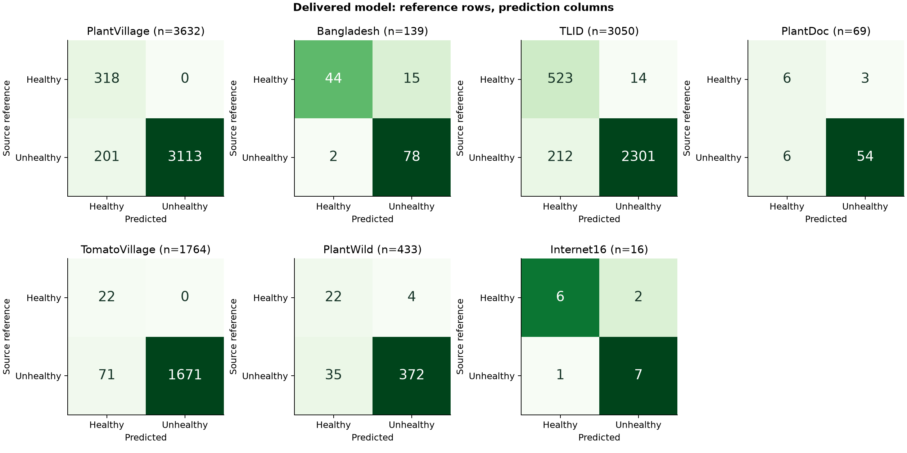
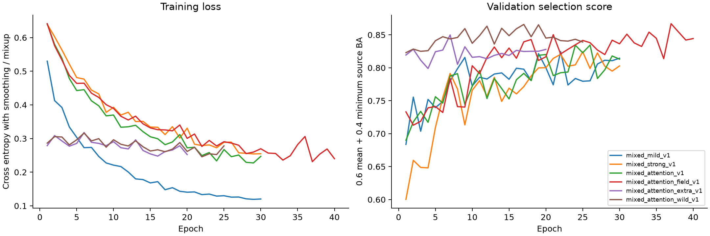

# Measured results — custom tomato-leaf CNN

All learned weights originated from random initialization in our custom CNN. Later stages continue only our own checkpoints with joint replay. No ResNet or externally pretrained model was used. The delivered model is D: seven-source continuation, selected using identical seven-source validation cohorts before its final test evaluation.

## Delivered model

Checkpoint: `best_model.pt` (3.67 MiB). Source run: `mixed_attention_wild_v1`. Decision threshold: 0.5. Labels: Healthy / Unhealthy.

| Evaluation | Images | Accuracy | Balanced accuracy | Macro F1 | Healthy recall | Unhealthy recall |
|---|---:|---:|---:|---:|---:|---:|
| PlantVillage | 3,632 | 94.47% | 96.97% | 86.43% | 100.00% | 93.93% |
| Bangladesh | 139 | 87.77% | 86.04% | 86.99% | 74.58% | 97.50% |
| TLID | 3,050 | 92.59% | 94.48% | 88.78% | 97.39% | 91.56% |
| PlantDoc | 69 | 86.96% | 78.33% | 74.73% | 66.67% | 90.00% |
| TomatoVillage | 1,764 | 95.98% | 97.96% | 68.09% | 100.00% | 95.92% |
| PlantWild | 433 | 90.99% | 88.01% | 74.02% | 84.62% | 91.40% |
| Internet16 | 16 | 81.25% | 81.25% | 81.18% | 75.00% | 87.50% |

Additional checks use different evaluation units and are not included in the five-source benchmark target.

| Additional check | Images/regions | Accuracy | Balanced accuracy | Macro F1 |
|---|---:|---:|---:|---:|
| TomatoDisease_ROI | 488 | 93.85% | 93.62% | 85.10% |
| GTLD_examples | 7 | 85.71% | 91.67% | 78.79% |

TomatoDisease_ROI uses supplied annotation crops with context, not automatic localization in whole photographs. Its binary Healthy mapping was recovered by uniquely matching the releasing authors' annotation count and visually checking training examples. GTLD contains just seven published examples with one Healthy photo. Neither check establishes internet-wide accuracy.

The predefined five-source target of 90% balanced accuracy was met on 3/5 sources. Below target: Bangladesh, PlantDoc. Later PlantWild and annotated-region checks are reported separately.

Web-photo agreement: 13/16. This is an old, small convenience sample with uncertain health labels. It does **not** estimate accuracy across random internet images. No test photos were added to training and no parameters were selected from these predictions.

## New curated internet-scene benchmark

PlantWild holdout: 433 photographs, 26 apparently Healthy and 407 source-labelled Unhealthy. Accuracy 90.99%, balanced accuracy 88.01%, macro F1 74.02%. Always predicting Unhealthy would score 94.00% accuracy but 50% balanced accuracy.

Eligibility and reference screening were frozen before any PlantWild predictions. Photos from the same source page and detected duplicate families were grouped. Healthy references were visually screened; disease references use published source categories. This is a conditional curated internet-image benchmark, not a probability sample of the internet, and labels are not independent biological diagnoses. [PlantWild source](https://tqwei05.github.io/PlantWild/).

## Source transfer and matched comparison

| Evaluation | A: four sources BA | B: five sources BA | C: six sources BA | Delivered BA |
|---|---:|---:|---:|---:|
| PlantVillage | 97.74% | 96.92% | 99.10% | 96.97% |
| Bangladesh | 82.87% | 91.97% | 82.43% | 86.04% |
| TLID | 91.42% | 94.97% | 93.82% | 94.48% |
| PlantDoc | 75.28% | 81.67% | 82.50% | 78.33% |
| TomatoVillage | 56.47% | 89.39% | 97.30% | 97.96% |
| PlantWild | — | — | — | 88.01% |
| Internet16 | 68.75% | 75.00% | 75.00% | 81.25% |

The frozen experiment-A model was also tested on all 4,525 Tomato-Village images as an entirely unseen source: accuracy 95.49%, balanced accuracy 61.35%, macro F1 65.50%. Experiment B trained on a grouped portion of this source; its valid holdout is 1,764 images, not the entire source.

Adding field data changes both source variety and effective sampling; this experiment does not isolate one cause of any improvement. B/C were compared on the same six-source validation cohorts; C/D were compared on the same seven-source validation cohorts before the new PlantWild holdout was examined. The delivered model was selected from validation, not whichever checkpoint happened to score better on web photos.

## Uncertainty

| Dataset | Group-bootstrap 95% interval: balanced accuracy |
|---|---:|
| PlantVillage | 96.4%–97.5% |
| Bangladesh | 79.9%–91.5% |
| TLID | 93.6%–95.3% |
| PlantDoc | 61.1%–95.2% |
| TomatoVillage | 96.9%–99.0% |
| PlantWild | 79.8%–94.2% |
| Internet16 | 58.9%–100.0% |

Intervals resample recorded groups. They do not account for missing garden/session IDs or incorrect labels. PlantDoc has only nine Healthy test images after the overlap audit; Tomato-Village has 22. Legacy benchmark tests have been inspected in earlier work, so comparisons are exploratory. High overall accuracy can hide poor Healthy recall.

Individual web-photo predictions and their source references are recorded in `evaluation_final/predictions.csv`. Original photographs and local preview galleries are excluded from this repository.

## Training and artifacts

`evaluation_a/`, `evaluation_b/`, `evaluation_c/` and `evaluation_final/` contain frozen checkpoint identities, every prediction, per-category results and full metrics. `runs/` contains configurations, validation histories, imported-source snapshots and actual training draw counts. `data/` contains audited manifests, source metadata and local image caches. See `EXPERIMENT_PROTOCOL.md` for source attribution, splitting, selection and limitations.

The model expects a clear photograph of tomato foliage. It has no species detector, leaf locator, reliable out-of-distribution rejection or independently verified diagnostic ground truth. If the benchmark target or web test remains weak, the objective of dependable arbitrary internet performance remains unfinished; these results must not be called solved.
