# Measured binary tomato CNN results

All scores below come from saved predictions of the two completed models. Unhealthy includes the source disease/pest/damage categories. These classifiers do not identify a specific disease.

| Dataset / cohort | Images | Accuracy | Balanced accuracy | Macro F1 | Healthy recall | Unhealthy recall |
|---|---:|---:|---:|---:|---:|---:|
| plantvillage / primary | 3,632 | 99.86% | 99.92% | 99.57% | 100.00% | 99.85% |
| bangladesh / primary | 139 | 94.96% | 94.07% | 94.75% | 88.14% | 100.00% |
| bangladesh / full_holdout_uncertain_labels | 160 | 83.75% | 83.75% | 83.31% | 67.50% | 100.00% |

These cohorts differ and must not be treated as a controlled ranking of real-world performance. PlantVillage uses controlled images and a previously inspected benchmark split. Bangladesh's primary score applies to 139 predefined images whose supplied filename and annotation labels agree; the full 160-image holdout includes 21 contradictory labels and is only a descriptive check against uncertain filename labels. Neither model has established performance in new gardens.

## Architecture and study design

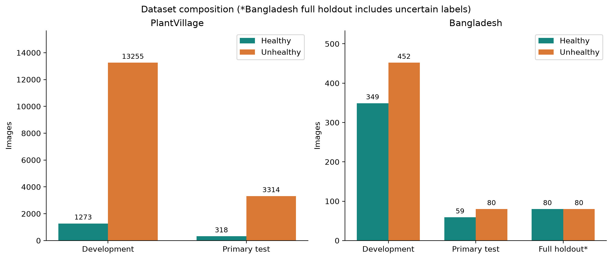

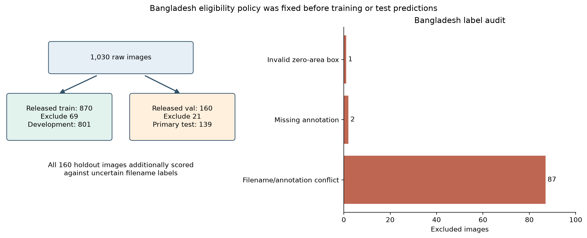

## Reusable report material

Every numerical chart is available as both PNG and editable SVG in figures/. RESULTS.csv contains fractional scores, not percentages. Each result folder also contains class_metrics.csv, cv_summary.csv, confidence_intervals.csv, roc_points.csv, precision_recall_points.csv, and image-level prediction CSVs. Use figures/README.md for suggested captions and interpretation.

## PlantVillage

The primary test recognized **318 / 318 Healthy** and **3309 / 3314 Unhealthy** leaves.

| Metric | Value |
|---|---:|
| Accuracy | 99.86% |
| Balanced accuracy | 99.92% |
| Macro F1 | 99.57% |
| Weighted F1 | 99.86% |
| Unhealthy precision | 100.00% |
| Unhealthy recall | 99.85% |
| Healthy recall | 100.00% |
| Unhealthy F1 | 99.92% |
| Healthy precision | 98.45% |
| Healthy F1 | 99.22% |
| ROC AUC | 0.9999 |
| Average precision | 1.0000 |

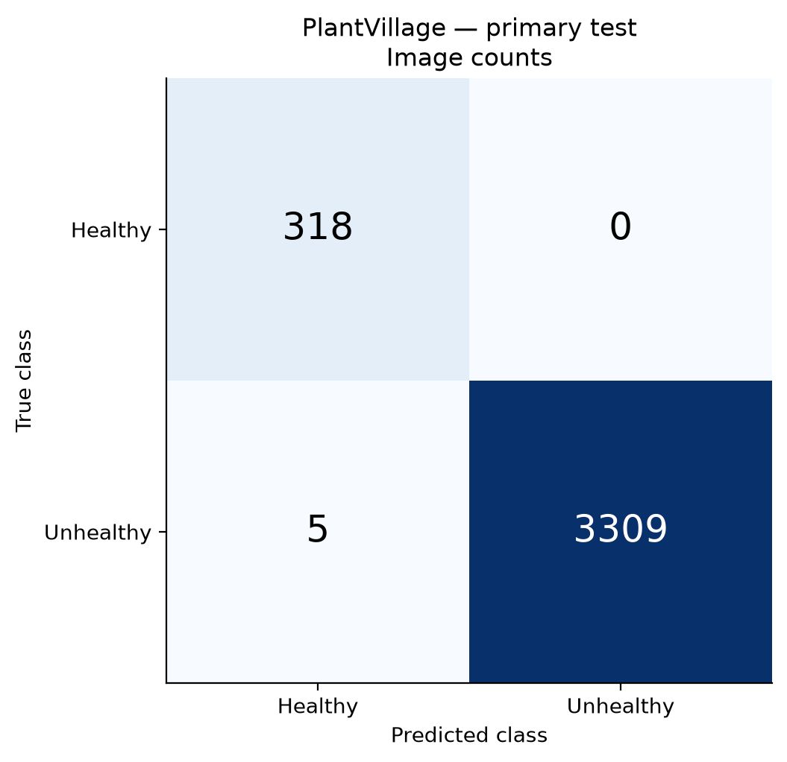

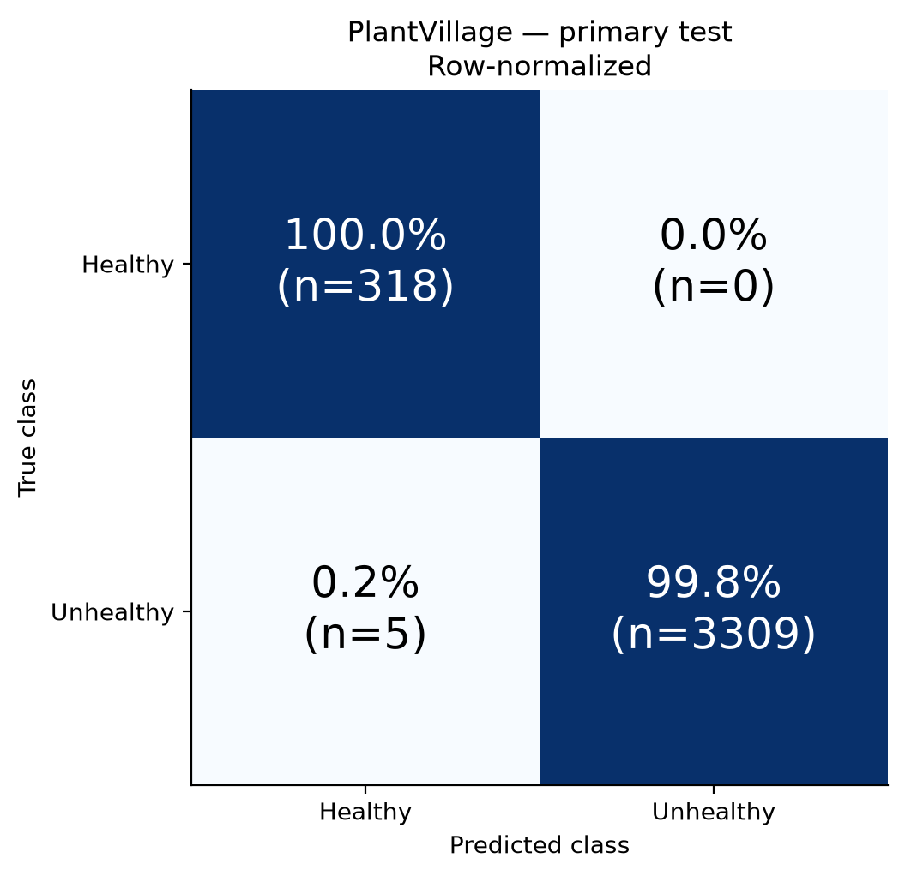

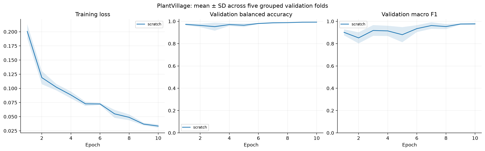

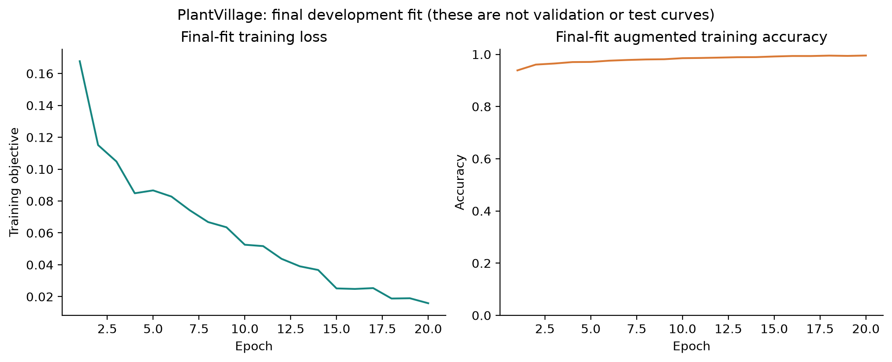

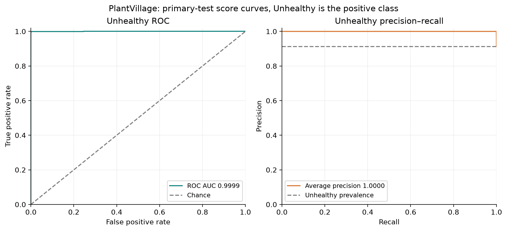

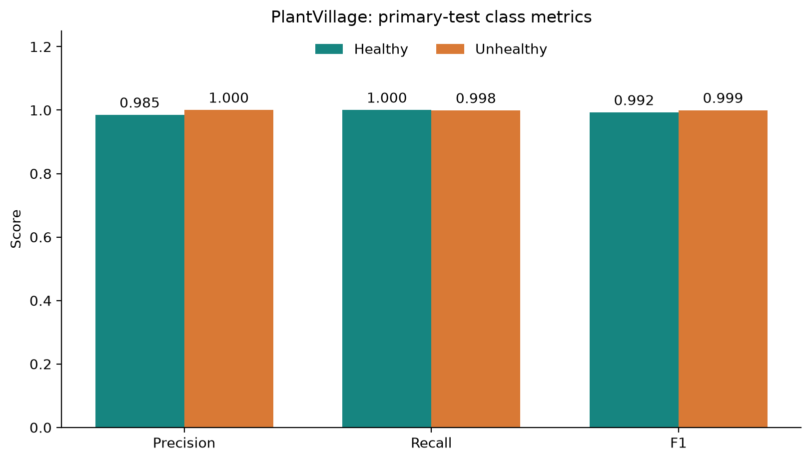

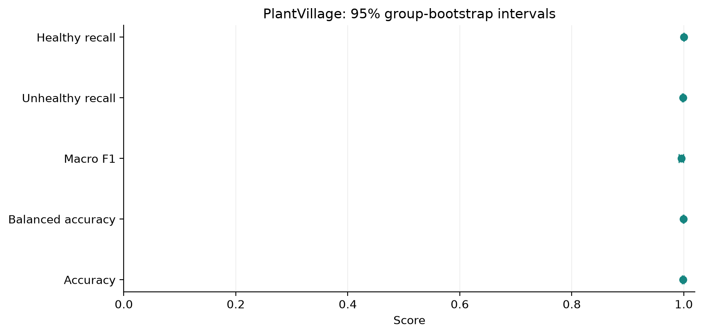

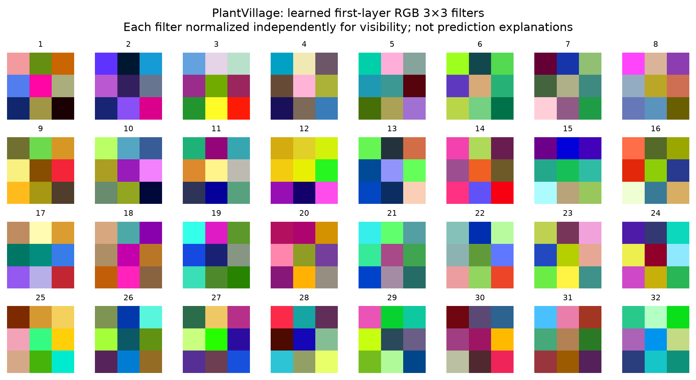

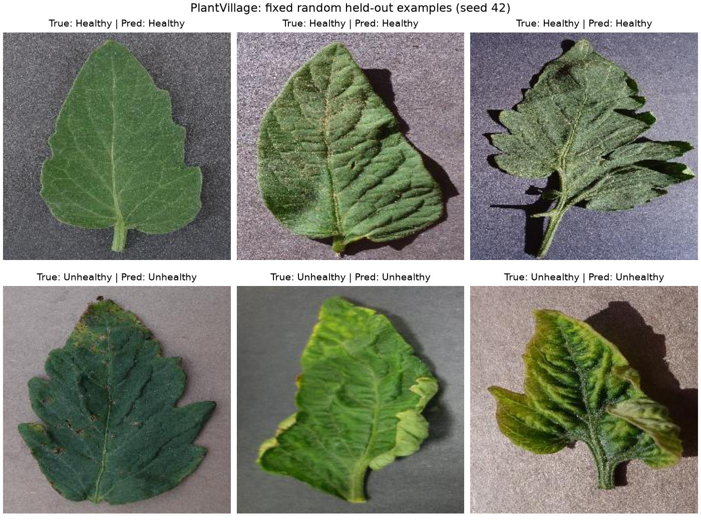

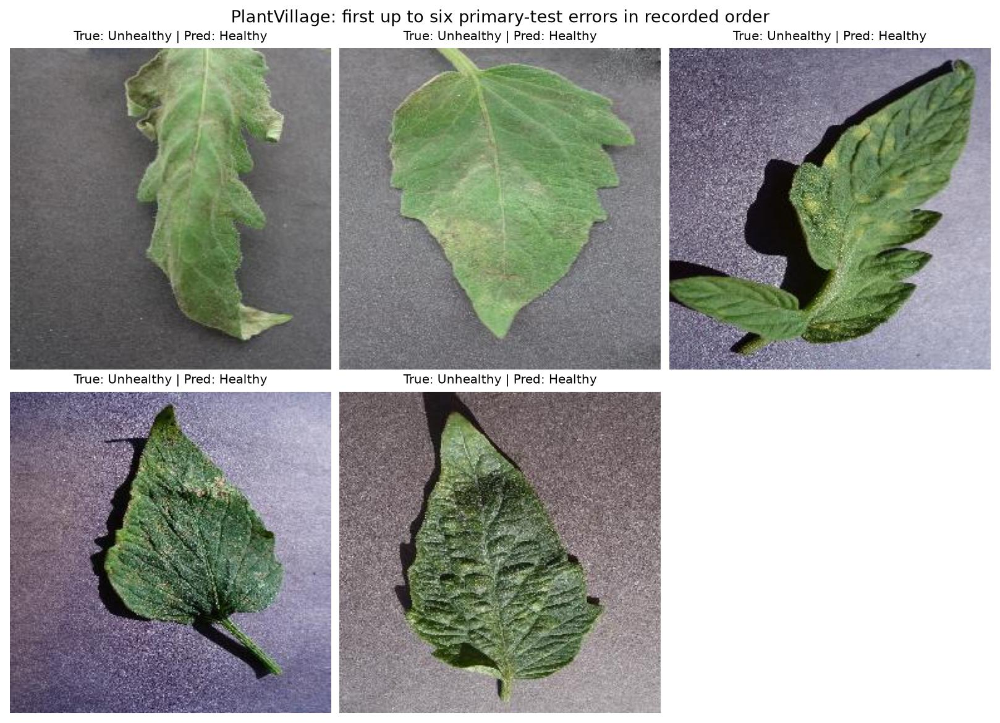

## Bangladesh

The primary test recognized **52 / 59 Healthy** and **80 / 80 Unhealthy** leaves.

| Metric | Value |
|---|---:|
| Accuracy | 94.96% |
| Balanced accuracy | 94.07% |
| Macro F1 | 94.75% |
| Weighted F1 | 94.91% |
| Unhealthy precision | 91.95% |
| Unhealthy recall | 100.00% |
| Healthy recall | 88.14% |
| Unhealthy F1 | 95.81% |
| Healthy precision | 100.00% |
| Healthy F1 | 93.69% |
| ROC AUC | 1.0000 |
| Average precision | 1.0000 |

## Interpretation and limits

Healthy recall is the fraction of healthy leaves recognized as healthy (also called specificity when Unhealthy is the positive class). Unhealthy recall is sensitivity. Macro F1 gives both classes equal weight; weighted F1 and overall accuracy can obscure a minority-class failure.

95% intervals use 2,000 bootstrap resamples of the recorded image/similarity groups. These groups have incomplete plant/photo-session metadata. The intervals do not capture all label, source-grouping, or deployment uncertainty; a degenerate interval from no observed class errors does not prove perfect future recall.

Both models use the same 939,874-parameter custom CNN at 128×128 RGB, [-1,1] normalization, and fixed argmax decisions. PlantVillage uses class-weighted CE and a fixed scratch recipe with five CV estimates. Bangladesh compares scratch against PlantVillage feature adaptation using mean final-epoch CV balanced accuracy, then refits the selected scratch recipe. Each CV fit uses 10 epochs; final fits use 20. Bangladesh uses exactly 32/32 class draws per training batch, without additional class weights. Full training configurations and artifact import provenance are in each experiment.json.
