# Bangladesh: binary results

See ../README.md for setup, ../DATA_SOURCES.md for provenance, and ../RESULTS.md for the combined report.

## Bangladesh

The primary test recognized **52 / 59 Healthy** and **80 / 80 Unhealthy** leaves.

| Metric | Value |
|---|---:|
| Accuracy | 94.96% |
| Balanced accuracy | 94.07% |
| Macro F1 | 94.75% |
| Weighted F1 | 94.91% |
| Unhealthy precision | 91.95% |
| Unhealthy recall | 100.00% |
| Healthy recall | 88.14% |
| Unhealthy F1 | 95.81% |
| Healthy precision | 100.00% |
| Healthy F1 | 93.69% |
| ROC AUC | 1.0000 |
| Average precision | 1.0000 |

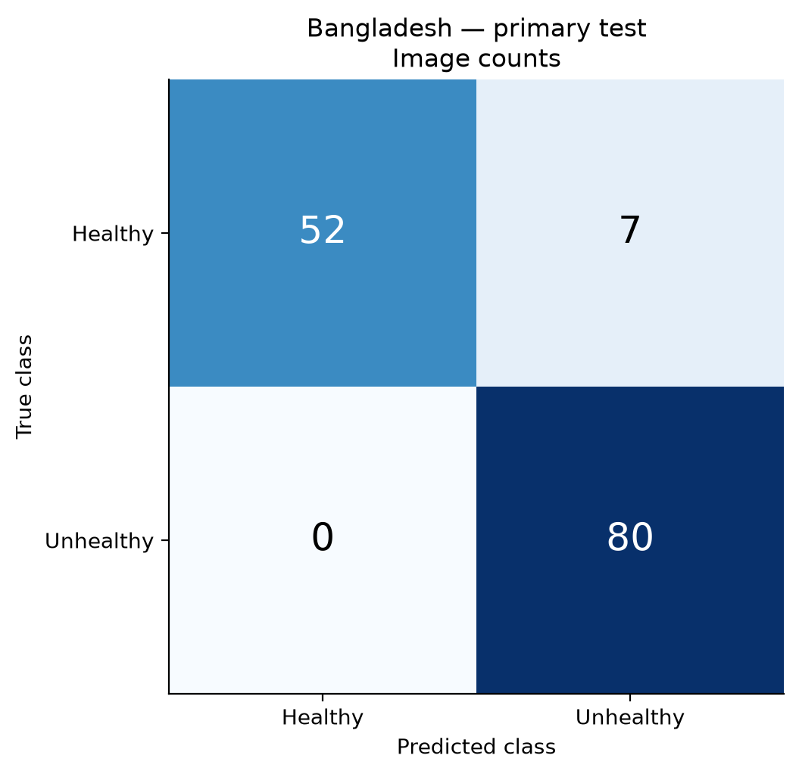

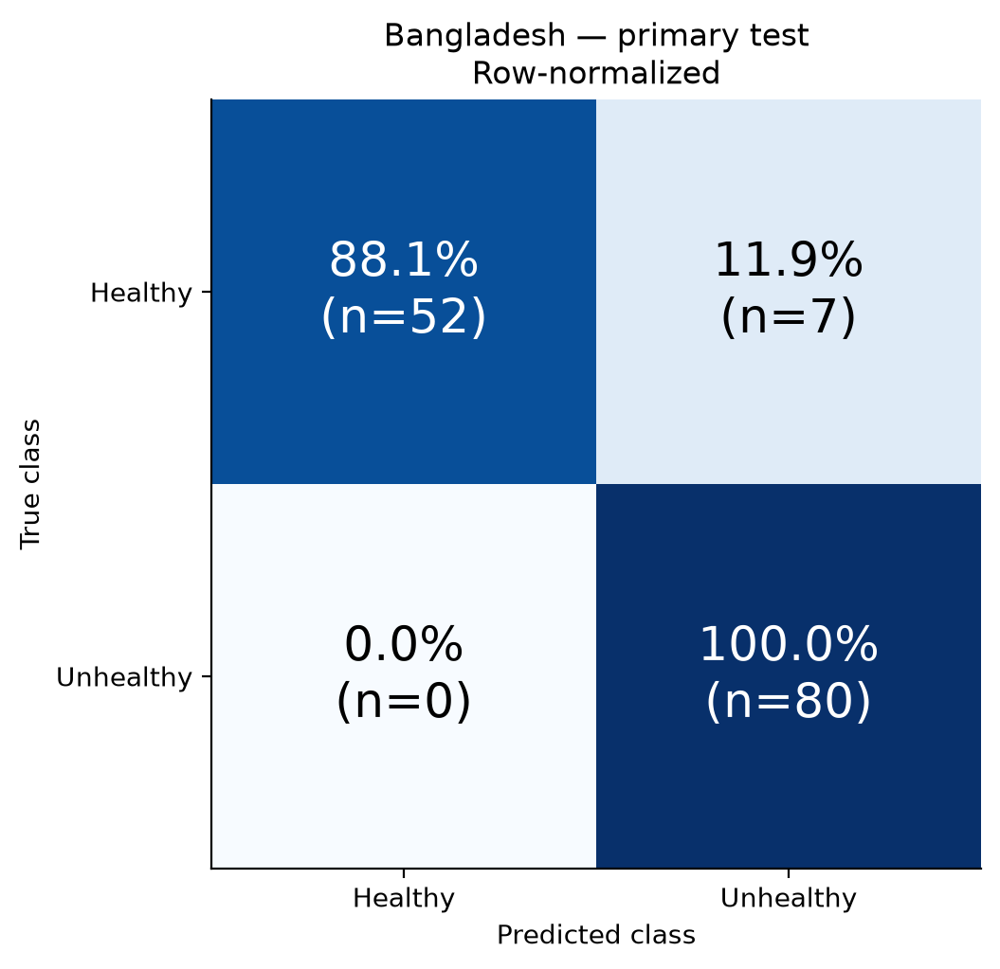

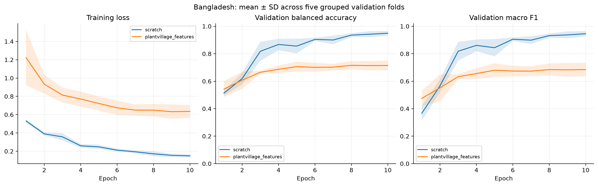

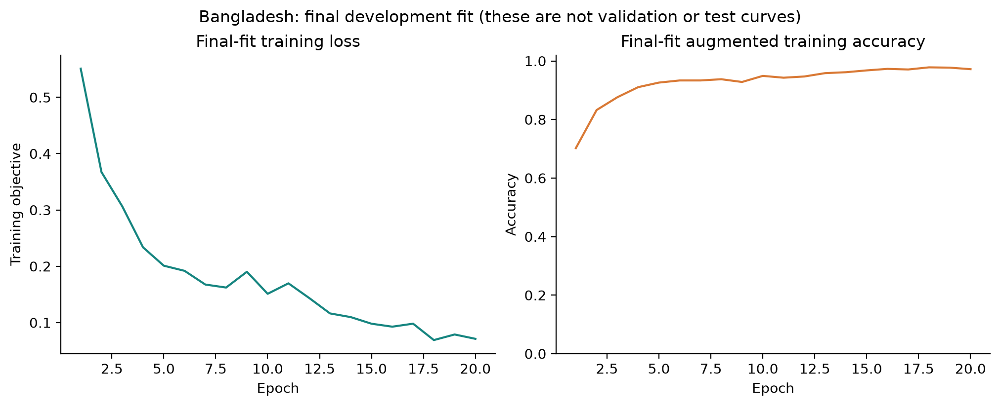

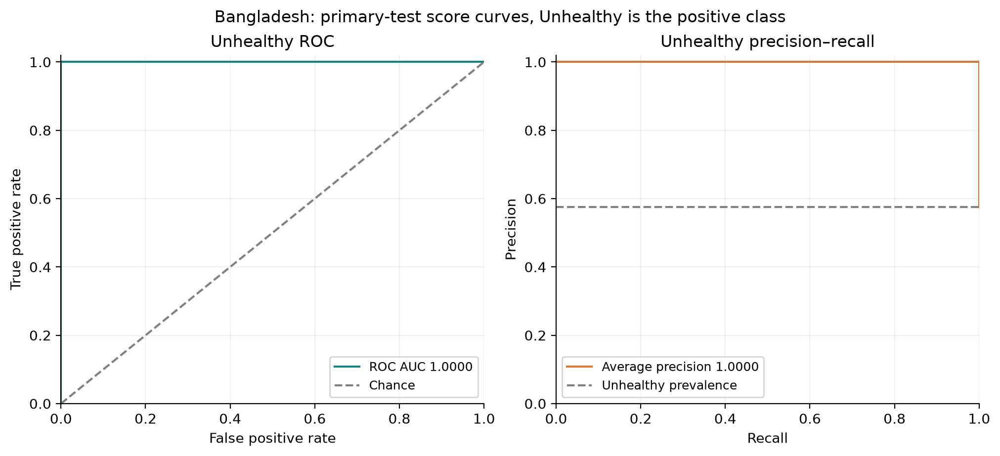

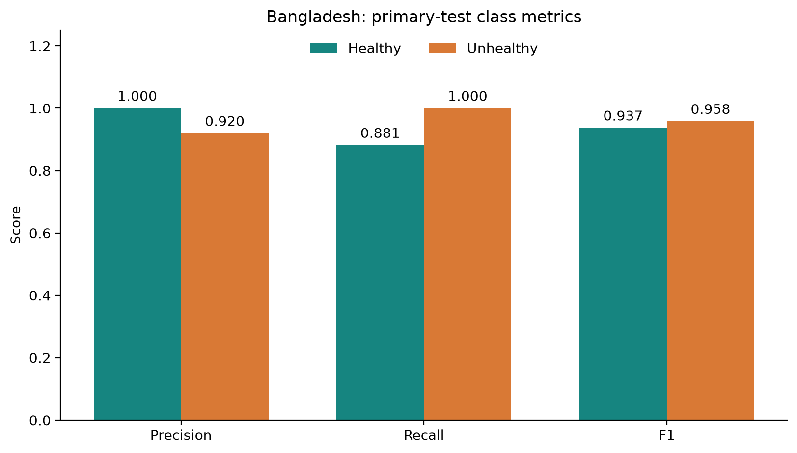

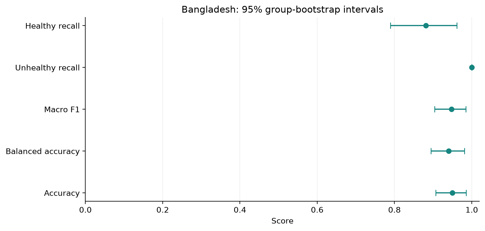

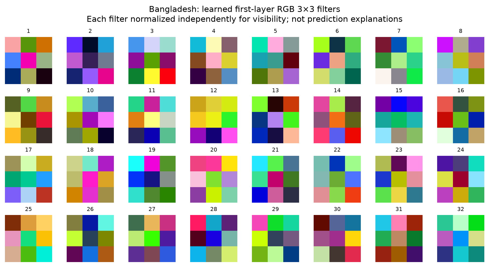

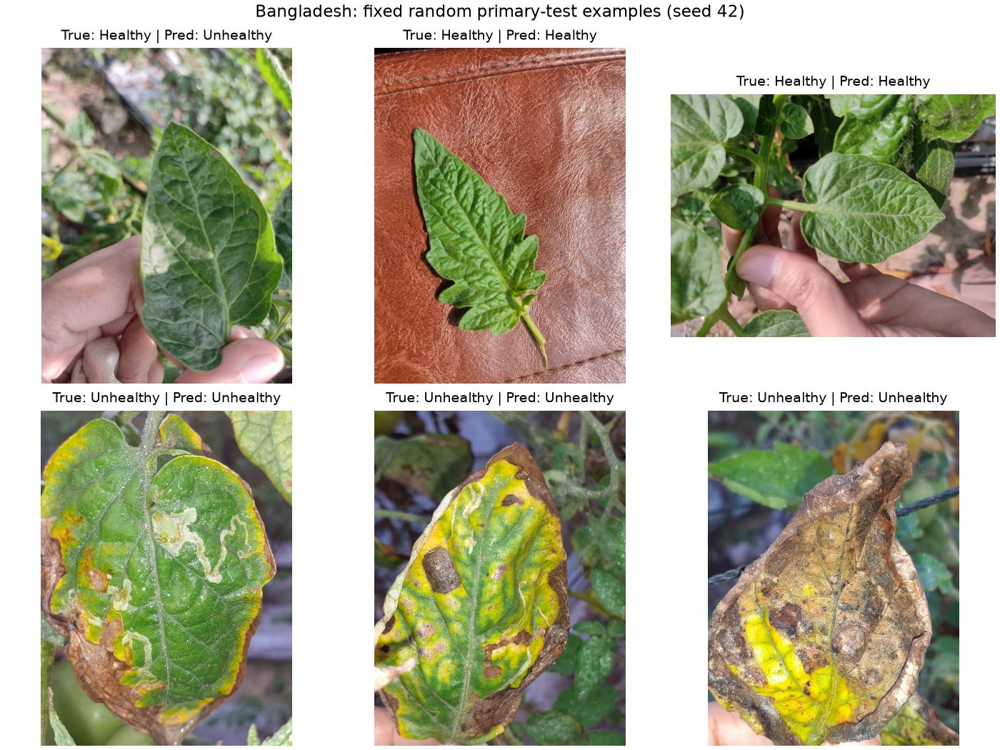

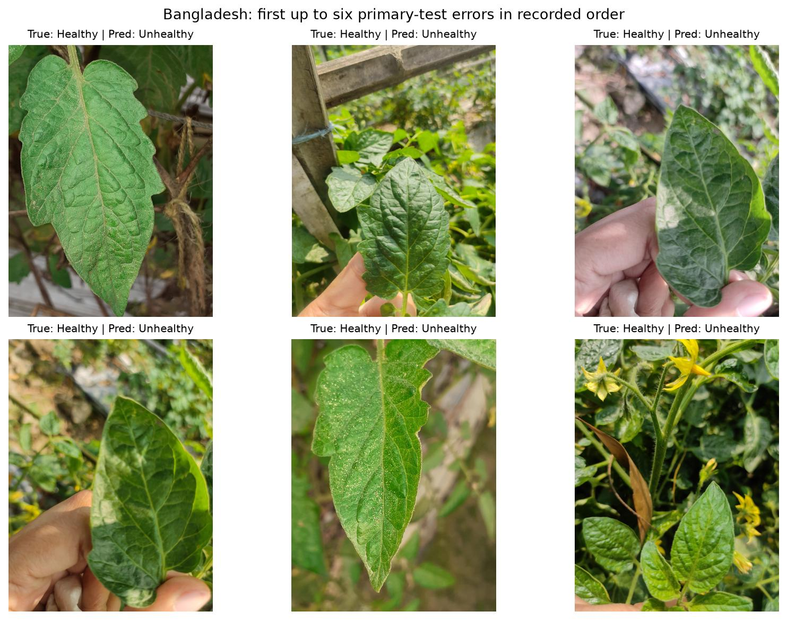

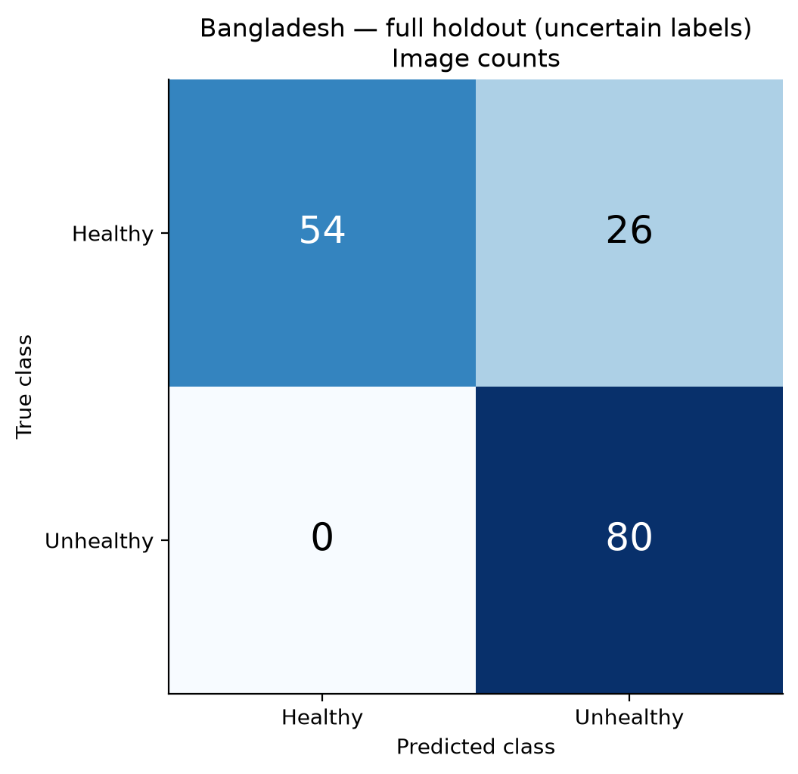
